# Abnahme Paket 2 — 9. November 2026

Maßnahmen 5 und 6 aus [`PLAN.md`](PLAN.md). Rechenkern, Abruf und Modell unverändert. Nicht gemergt, nicht deployed.

Die orangefarbene Linie ist der Falz: 900 px bei 1440, 844 px bei 390. Die Bilder sind etwas höher als das Fenster, damit die Linie im Bild liegt. Gemessen wurde die Kurvenoberkante im Fenster 1440×900 bzw. 390×844.

## Kurve im ersten Fenster

| Seite | Fenster | Kurvenoberkante vorher | nachher |
| --- | --- | --- | --- |
| `/monat/2026-10` | 1440×900 dunkel | 1025 px | 586 px |
| `/monat/2026-10` | 390×844 hell | 1432 px | 806 px |
| `/ort` | 1440×900 dunkel | 969 px | 558 px |
| `/ort` | 390×844 hell | 954 px | 553 px |

`scrollWidth` bei 390 px ist 390, hell und dunkel, auf beiden Seiten.

### Vorher

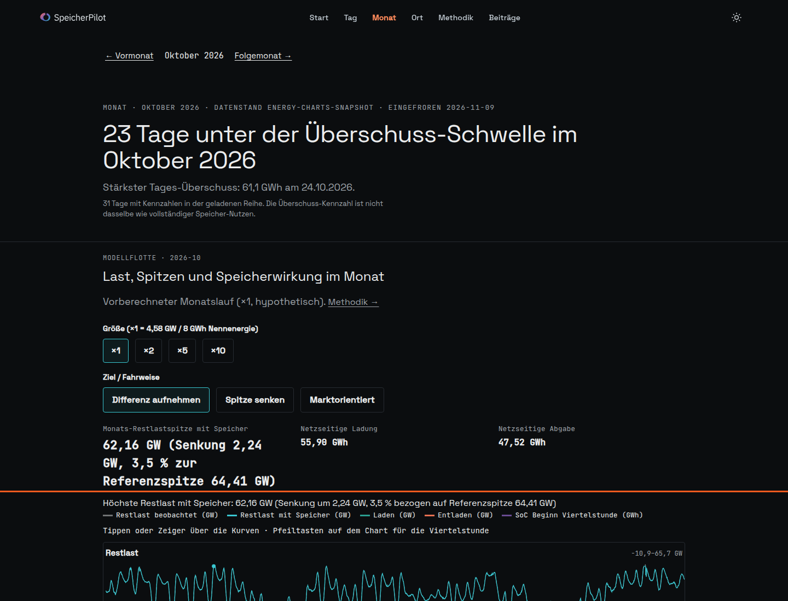

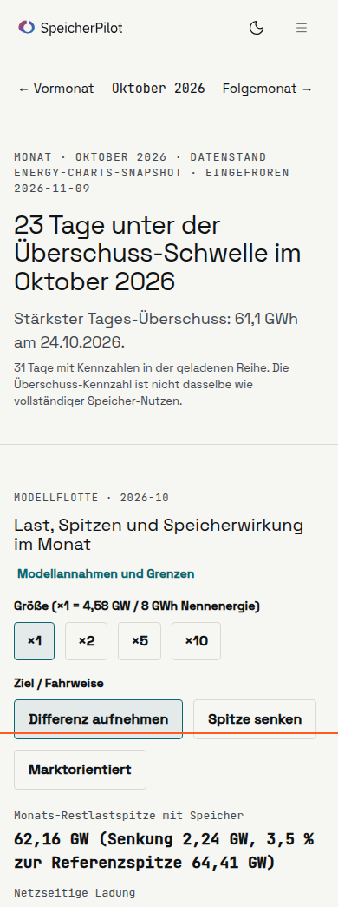

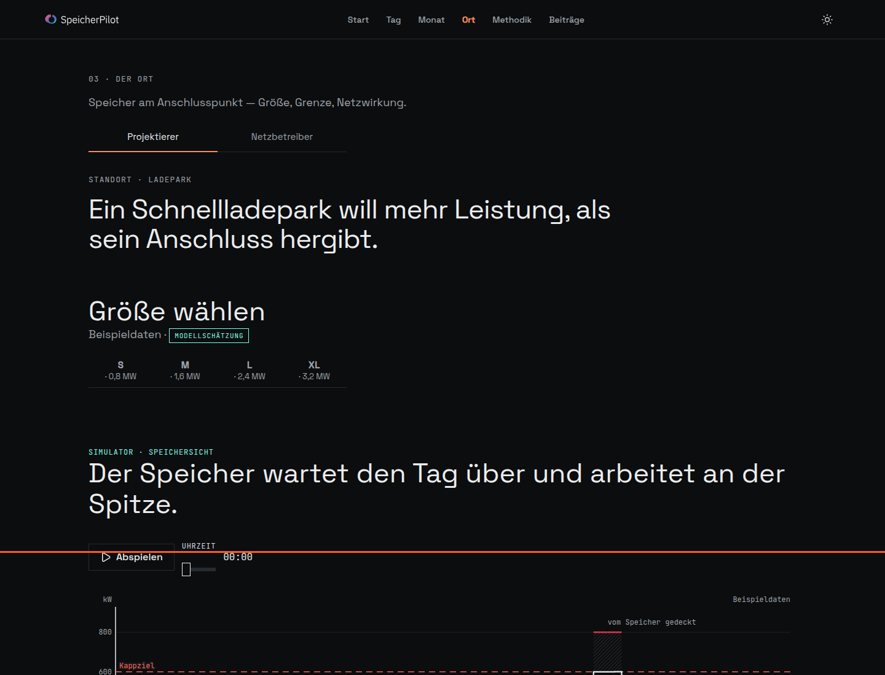

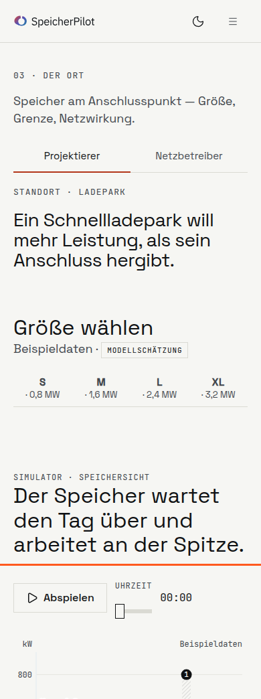

### Nachher

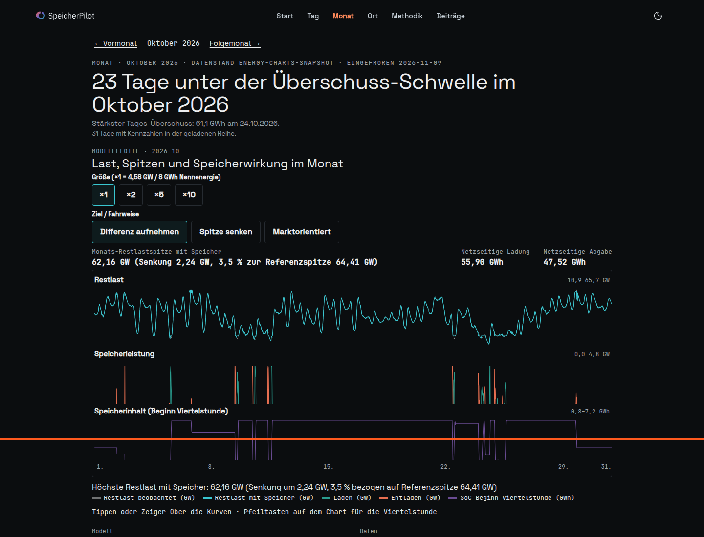

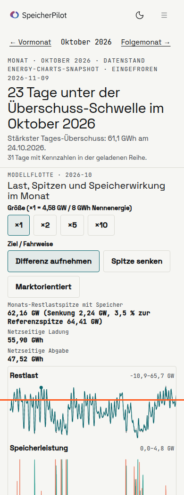

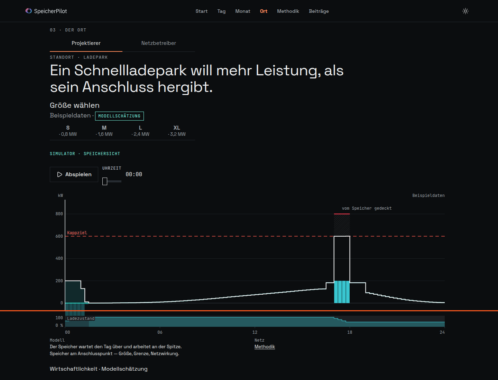

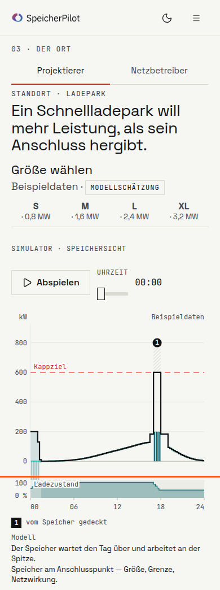

## Was sich verschoben hat

Der erste Stand dieser Runde ließ Spitze, Ladung und Abgabe über der Kurve. Die Designabnahme unten hat das auf dem schmalen Fenster geändert: dort stehen die drei Werte unter der Kurve. Auf dem Desktop bleiben sie in einer Zeile. Sätze ohne die Kennzahl — Monatslauf, Modellannahmen, Quellenzeile, „nicht dasselbe wie vollständiger Speicher-Nutzen“ — stehen unter der Kurve als Definitionsliste, 13 px, Link auf `/methodik#grossspeicher`.

Auf `/ort` bleibt der Befundsatz über der Anschlusskurve. Größe und Abspielen bleiben darüber. „Der Speicher wartet …“ und „Speicher am Anschlusspunkt …“ stehen darunter, gleiche Listenform, Link auf `/methodik`. Projektierer und Netzbetreiber sind unverändert getrennt. Die Badge-Regel v1 ist nicht angefasst.

## Dieselben Zahlen

Oktober ×1, Differenz aufnehmen, Text vorher (live, main `dfb2f88`) und nachher identisch:

- Spitze 62,16 GW
- Senkung 2,24 GW (3,5 % zur Referenzspitze 64,41 GW)
- Ladung 55,90 GWh
- Abgabe 47,52 GWh

`/ort` Projektierer, Größe S: 0,8 MW. Amortisation ≈ 34,6 Jahre (23,8–63,6). Benutzungsdauer 600 h → 632 h. Netzentgelt ≈ 1.443 €/Jahr (1.010–1.876). Arbitrage ≈ 9.526 €/Jahr (6.668–12.383).

`/ort?sicht=netz`, Land, Markt: Badge belastend (Modell). Fest/flexibel 0,0 / 17,0 MW. Modellerlös 100,0 %. Viertelstunden über 100 %: ohne Speicher 31, mit Speicher 29. Engpass max 117,2 %.

## Lighthouse

Produktionsserver, lokal. Mobil 390×844, Desktop Preset.

| Seite | Performance | Accessibility | Best Practices | SEO | CLS |
| --- | --- | --- | --- | --- | --- |
| `/monat` mobil | 91 | 100 | 100 | 100 | 0 |
| `/monat` Desktop | 100 | 100 | 100 | 100 | 0 |
| `/ort` mobil | 86 | 100 | 100 | 100 | 0 |
| `/ort` Desktop | 100 | 100 | 100 | 100 | 0 |

## Tests

`pnpm test`: 144 Suites bestanden, 3 übersprungen, 637 Tests bestanden. ESLint auf den geänderten Dateien: 0 Fehler. `pnpm build`: erfolgreich.

## Designabnahme, gleiche Runde

Die erste Abnahme war NEIN. Die Zahlen oben bleiben. Geändert hat sich nur die Anordnung.

Auf `/monat` bei 1440 enden alle drei Diagrammflächen bei höchstens 771 px (Grenze 880). Die Überschrift ist eine Zeile, 36 px. Größe und Ziel stehen in einer Zeile. Die Kennzahlen bleiben in einer Zeile, einschließlich der Senkungsklammer.

Auf `/monat` bei 390 stehen im ersten Fenster nur die Überschrift (zwei Zeilen), die Zeile „Okt 2026 · Datenstand 09.11.2026“, die beiden Schalter und die Kurve. Die Achse endet bei 839 px, die Farblegende beginnt bei 848 px. Darunter die Kennzahlen nur als Spitze, Ladung und Abgabe. In der Definitionsliste stehen Modellflotte, Größe, Ziel, die Senkungsklammer, der stärkste Tages-Überschuss und die 31 Tage.

`pnpm test` danach: 144 Suites bestanden, 638 Tests bestanden. Die Kurvenhöhe ist vor dem Laden reserviert. Lighthouse auf dem Produktionsserver: Accessibility 100. CLS auf `/monat` Desktop 0,002, mobil 0,0004. `/ort` mobil und Desktop CLS 0, Accessibility 100. `scrollWidth` bei 390 px ist 390.

Auf `/ort` bei 390 liegt der Abstand der y-Beschriftung zur Gitternetzlinie bei 10 px. In der Netzbetreiber-Ansicht bei 1440 sind die Achsenbeschriftungen mindestens 12 px. Badge und Perspektiven sind nicht angefasst.

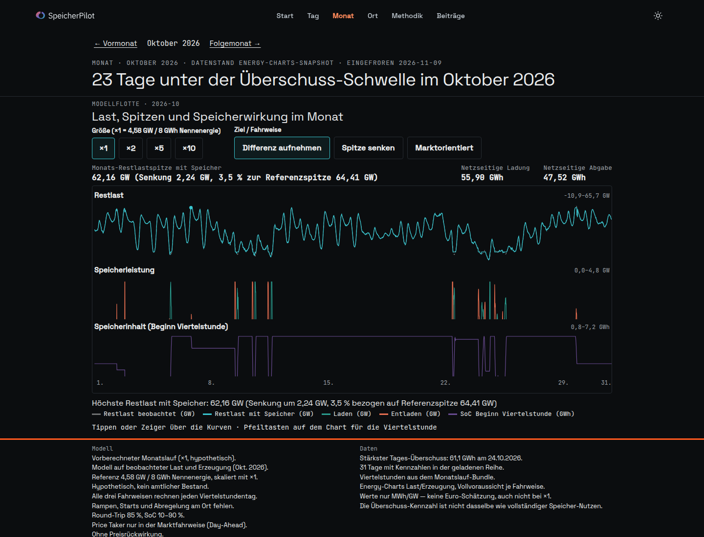

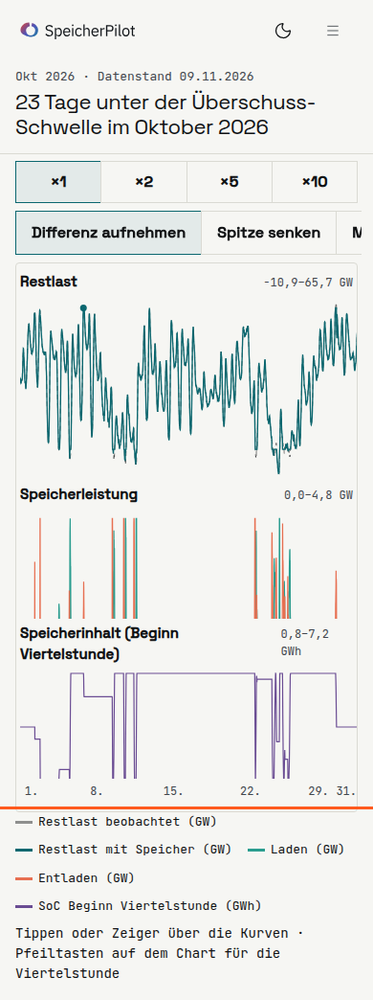

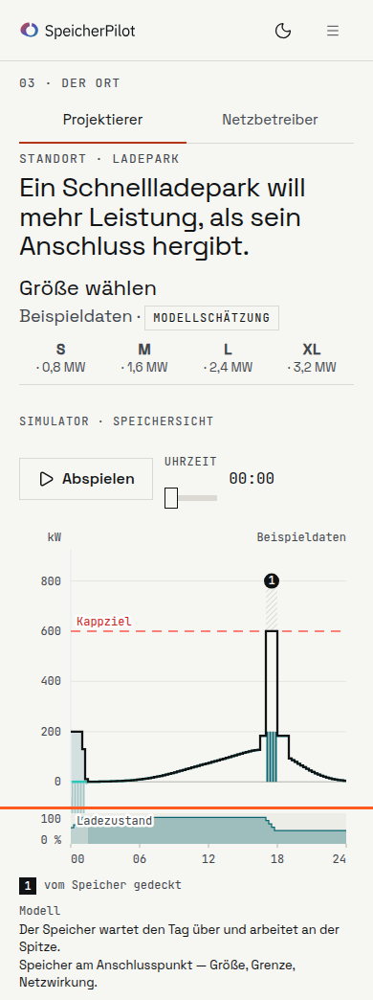

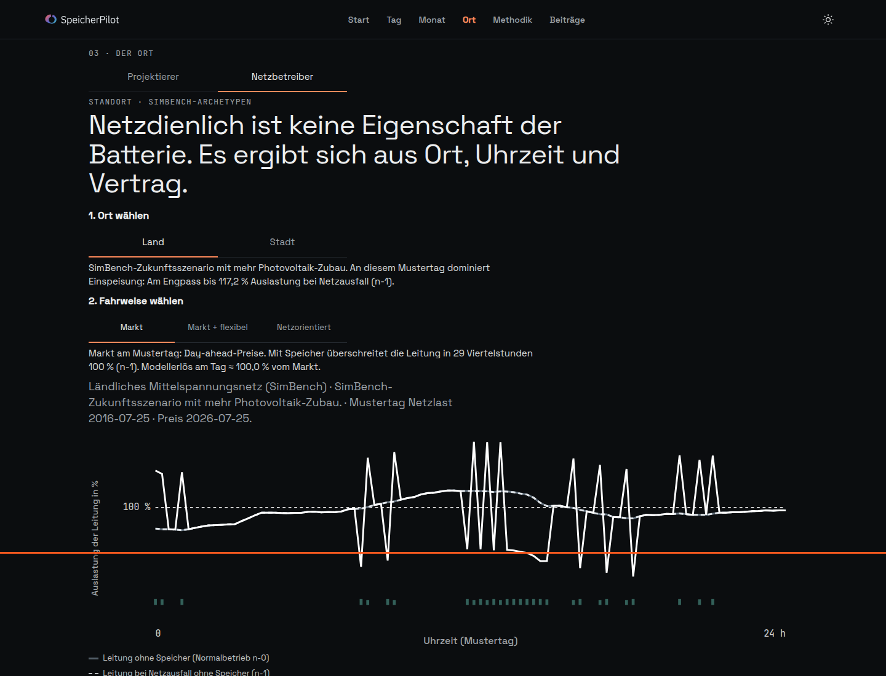
