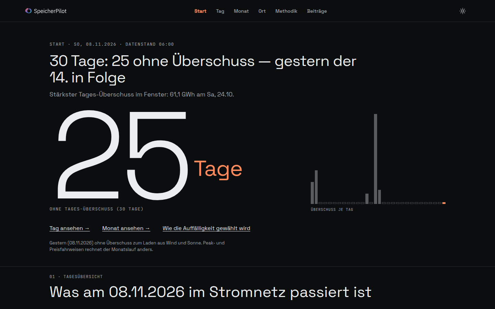
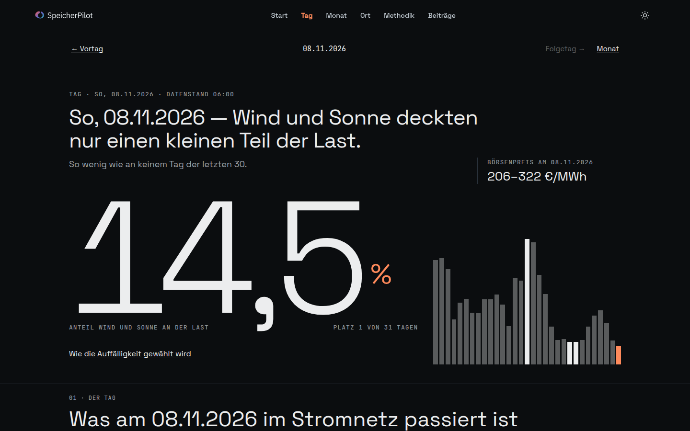
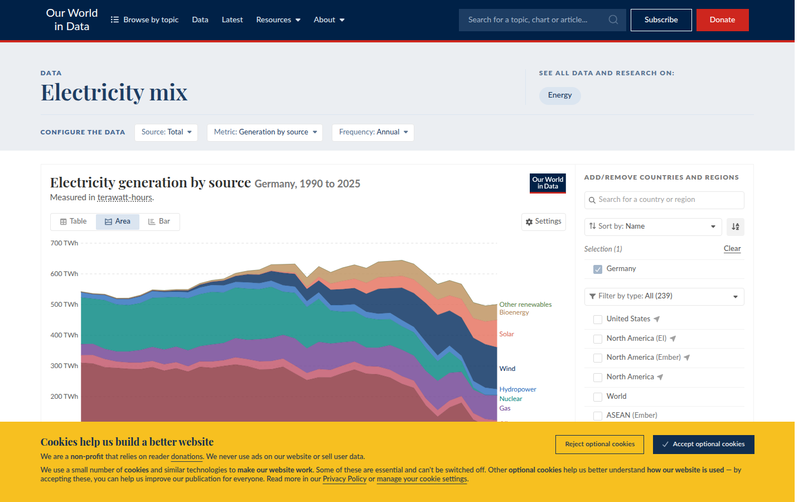
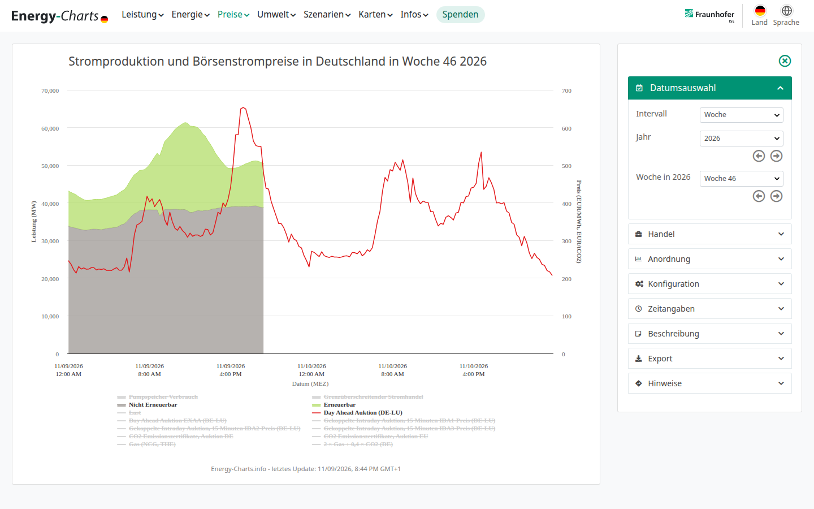
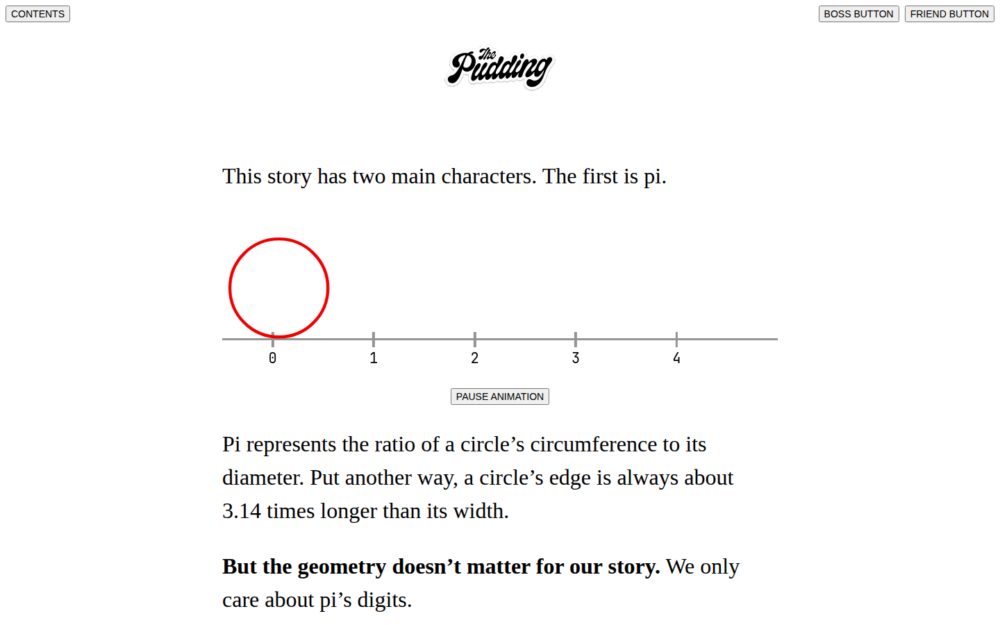
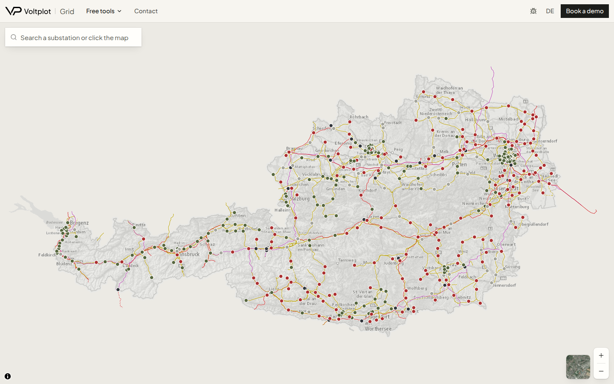

# Konzept-Audit SpeicherPilot — 9. November 2026

Live: [https://www.speicherpilot.app](https://www.speicherpilot.app). Gelesen am Abend des 9. November 2026 (Europe/Berlin). Repo-Stand der Live-Seite: `dfb2f88` (Startseite mit Kernwerten und 30-Tage-Balken, PR 77). Audit 1 in [`../AUDIT.md`](../AUDIT.md) hat die Optik bewertet. Dieser Text bewertet die Story.

Messlatte ist Phillipps Auftrag vom selben Tag: eine Seite, die Projektierer, einen städtischen Netzplaner und ein Institut benutzen wollen, weil Tag, Monat und Markt zusammenkommen. Insights sind regelbasierte Sätze aus öffentlichen Zahlen. Änderungen an der bestehenden Seite bleiben vorsichtig. Der Rechenkern bleibt: Round-Trip 85 % (Spanne 80–90), Ladezustand 10–90 %, Preisnehmer, nur Day-Ahead. Euro nur bei ×1 und nur als Modellschätzung.

## Drei Befunde

1. **Im Herbst erzählt die Seite die Leere.** Vom 10. Oktober bis zum 8. November haben 25 von 30 Tagen unter 0,05 GWh Wind-Solar-Überschuss. Die Startseite macht daraus die große 25. Der November-Monat sagt denselben Befund und setzt dazu den Satz, das sei kein Urteil „null Speichernutzen“. Die Zahl, die den Nutzen trotzdem tragen würde, steht auf dieser Seite nicht.

2. **Die Day-Ahead-Spanne ist in diesen 25 Tagen nicht zusammengefallen.** Sie liegt zwischen 72 und 345 €/MWh. Der weiteste Tag, der 29. Oktober, hat 0,0 GWh Überschuss und einen Abendpreis von 574 €/MWh. Auf der Startseite ist dieser Tag einer von 25 grauen Strichen. Auf `/tag` steht der Preis als Spanne in der Ecke, die Kurve zeigt ihn nicht.

3. **Eine freie Netzanschlusskapazität für Deutschland, analog zur österreichischen Pflichtkarte, ist öffentlich nicht belegt.** Die Bundesnetzagentur veröffentlicht Anfragen und Zusagen als Jahressumme. Eine Karte „hier ist noch Anschluss frei“, für Hamburg oder bundesweit, gibt es in den geprüften Primärquellen nicht. `/ort` rechnet Beispiele, keine freie Kapazität.

## Was die Seite heute nicht kann

- Sie kann an einem Tag ohne Überschuss nicht sagen, ob der Speicher an der Börse trotzdem ein Fenster gehabt hätte. Sie druckt auf `/tag` die gerundete Spanne (am 8. November: 206–322 €/MWh) und zeichnet die 96 Viertelstunden nicht.
- Sie kann den November nicht simulieren. Peak- und Preisfahrweise gibt es als vorberechneten Lauf nur für Oktober 2026. Der Link „Monat ansehen“ vom 8. November landet auf einer Beobachtung ohne Modell.
- Sie kann die drei Oktober-Fahrweisen nicht in einem Satz gegenüberstellen. Wer die URL kennt, sieht sie. Die Startseite verweist in einer Fußnote darauf.
- Sie kann keinen Euro für die nationale Flotte zeigen, auch nicht bei ×1. Das ist auf `/monat` ausdrücklich so. Euro stehen auf `/ort` als Modellschätzung eines Beispielanschlusses.
- Sie kann keine lokale Netzwirkung bewerten. Der Satz steht auf der Startseite: „nicht bewertet“.
- Sie kann keine Abregelung in GWh nennen. Der Netztransparenz-Feed ist nicht angeschlossen.
- Sie kann einem Hamburger Netzplaner keine freie Kapazität am Umspannwerk nennen und keine städtische Residuallast. Die nahe öffentliche Reihe ist die Regelzone 50Hertz, und die ist nicht die Stadt.
- Sie kann kein Intraday, keine Regelleistung und keine Preiswirkung von mehr Speichern rechnen. Mehr Speicher würde die Spanne in Wirklichkeit drücken. Eine lineare Euro-Skalierung mit ×2, ×5 oder ×10 wäre falsch und ist zu Recht nicht da.
- Sie hat keine Marktseite. Die Navigation ist Start, Tag, Monat, Ort, Methodik, Beiträge.

## 1. Drei Fragen je Zielgruppe

Stand der Antworten: Live-HTML am 9. November 2026, letzter vollständiger Tag Sonntag, 8. November.

| Zielgruppe | Frage, mit der sie kommt | Antwort heute, mit Zahl | Lücke |
| --- | --- | --- | --- |
| Speicherprojektierer | An wie vielen Tagen der letzten Wochen war Wind und Sonne über der Last, und wie viel hätte die heutige Flotte davon geladen? | Start: 25 von 30 Tagen ohne Überschuss. Summe 115,6 GWh, Modell ×1 lädt 32,6 GWh (28 %). Fünf Tage, jeder mit 6,5 GWh Modell-Ladung. | Die 25 Tage bleiben in dieser Rechnung bei 0,0 GWh. Eine zweite Lesart (Preis, Spitze) ist ein Satz in der Fußnote. |
| Speicherprojektierer | Was war der Day-Ahead-Preis an so einem leeren Tag, Stunde für Stunde? | `/tag/2026-11-08`: „206–322 €/MWh“, neben der Kennzahl 14,5 % Wind+Sonne. | Keine Preiskurve. Kein Satz, dass das Minimum bei 206 €/MWh lag und keine Viertelstunde negativ war. |
| Speicherprojektierer | Was bringt mehr Speicher, und was wäre der Erlös der Flotte? | Oktober, nur wer die Fahrweise umschaltet: ×1 Marktfahrweise lädt 485,45 GWh und senkt die Spitze um 0,37 GW. Überschuss-Fahrweise lädt 55,90 GWh und senkt um 2,24 GW. | Kein Euro, auch nicht bei ×1. November ohne diese Rechnung. Die zwei Fahrweisen stehen nicht nebeneinander. |
| Netzplaner, zum Beispiel Hamburg | Wie hoch war die Abendspitze, und hätte Speicher sie gesenkt? | Tag 8. November: 58,5 GW um 17:15, Verbrauch 62,1 GW, Wind+Sonne 3,5 GW. Überschuss-Modell an diesem Tag: nichts geladen, nichts abgegeben. Oktober, Spitzenfahrweise ×1: Senkung 3,55 GW auf 60,86 GW. | Die 58,5 GW sind Deutschland, nicht Hamburg. Die Spitzenfahrweise gilt für Oktober und eine andere Flottengröße (4,58 GW / 8 GWh, nicht die 4,64 GW / 8,14 GWh der Startseite). |
| Netzplaner | Wo im Netz ist Anschluss frei? | `/ort` trennt Projektierer und Netzbetreiber und rechnet Beispiele (Schnellladepark, Modellanker 110 kV). Badge bleibt Schätzung. | Keine gemessene freie Kapazität. Siehe Frage 4. |
| Netzplaner | Belasten oder entlasten Speicher den Anschluss? | Ampel und Badge auf `/ort`, als Schätzung gekennzeichnet. Text: Netzdienlichkeit folgt aus Ort, Uhrzeit und Vertrag. | Kein Hamburger Lastgang, kein echtes Umspannwerk. |
| Institut | Kann ich die Zahl nachrechnen? | `/methodik`: Round-Trip 85 %, SoC 10–90 %, Preisnehmer, Day-Ahead, Formel des Überschusses, Quellen. | Dieselbe Disziplin fehlt für eine Preis-Kennzahl auf Start und Tag. Die Spanne 206–322 ist gerundet, die Reihe steckt nicht auf der Seite. |
| Institut | Was ändert sich, wenn die Flotte ×2, ×5, ×10 ist — an Energie und an der Spitze, je Fahrweise? | Oktober-Seite hat die vier Faktoren und drei Fahrweisen. Die Startseite zeigt die Überschuss-Aufnahme: ×1 28 %, ×5 75 %, ×10 100 %. | Die Startseite skaliert nur die Überschuss-Energie. Die Oktober-Marktfahrweise senkt die Spitze kaum, obwohl sie viel Energie bewegt. Dieser Gegensatz ist der Insight und steht auf keiner gemeinsamen Fläche. |
| Institut | Wie viele Stunden war der Preis negativ, und wie entwickelt sich das über die Monate? | Einzelne Tage können „niedrigster Preis“ als Auffälligkeit gewinnen. Im Fenster 10. Oktober bis 8. November sind es zwei Tage mit zusammen 1,75 Stunden unter null. | Keine Monatsreihe, kein Trend, keine eigene Marktseite. |

## 2. Saisonlücke

Das Überschuss-Modell lädt nur, wo Wind plus Sonne über der Last liegt, und auf der Tageskette nur vor 17 Uhr. Im geladenen Fenster trifft das auf fünf Tage zu. Die Seite zeigt die übrigen Tage als 0,0 GWh und, auf `/monat/2026-11`, als Satz ohne Balken: kein geladener Tag hat die Schwelle 0,05 GWh erreicht.

Dieselbe öffentliche Preisreihe, Gebotszone DE-LU, Viertelstunde, bleibt in diesen Tagen aussagekräftig. Drei Ankertage:

| Tag | Überschuss auf der Live-Seite | Day-Ahead min–max | Spanne | Stunden unter 0 |
| --- | --- | --- | --- | --- |
| Sa, 24.10., stärkster Überschuss | 61,1 GWh | 0,00–111,31 €/MWh | 111,31 | 0 |
| Do, 29.10., weiteste Spanne | 0,0 GWh | 229,70–574,28 €/MWh | 344,58 | 0 |
| So, 08.11., letzter vollständiger Tag | 0,0 GWh | 206,09–321,50 €/MWh | 115,41 | 0 |

Am 29. Oktober liegen fünf Viertelstunden über 500 €/MWh, gebündelt von 17:00 bis 18:15 (574,28 €/MWh um 17:15). Das ist eine Abendspitze im Preis, an einem Tag, den die Überschuss-Zahl als leer führt.

Am 8. November liegen die fünf günstigsten Viertelstunden zwischen 10:30 und 15:00 (206,09 bis 208,46 €/MWh) und die fünf teuersten zwischen 17:45 und 20:00 (318,15 bis 321,50 €/MWh). Die Reihenfolge wäre für einen Zyklus zeitlich möglich. Der Überschuss-Kern lädt trotzdem nicht, weil Wind und Sonne nie über der Last lagen. Beides ist wahr und gehört auf dieselbe Seite.

Gegenrechnung Spanne 8. November: 321,50 − 206,09 = 115,41 €/MWh. Dieselbe Spanne steht in der SMARD-Viertelstundenreihe (Filter 4169, Gebiet DE), auf die Viertelstunde gleich an 15:00, 17:45, 14:00 und 20:00. Die Seite rundet auf 206–322 €/MWh. Die Rundung ist nachvollziehbar. Die Kurve fehlt.

Was die Spanne nicht ist: ein Erlös. Am 8. November liegt das billigste Fenster bei etwa 208 €/MWh. Wer dort lädt, kauft teuren Strom. Negative Preise gab es im ganzen Fenster nur am 10. Oktober (eine Viertelstunde, −0,01 €/MWh) und am 25. Oktober (1,5 Stunden). Beide Tage haben auch Überschuss. Ab dem 28. Oktober liegt jedes Tagesminimum über 169 €/MWh, ab dem 29. Oktober über 200 €/MWh.

Der ehrliche Satz für den Herbst lautet deshalb: Überschuss und negative Preise sind weg, die Preisspanne ist geblieben, das Preisniveau ist hoch, die Abend-Residuallast ist mit 58,5 GW weit über der Flotte von 4,64 GW. Das Überschuss-Modell mit 0,0 GWh ist korrekt und unvollständig.

## 3. Was sich aus öffentlichen Reihen bündeln lässt

Alles hier ist aus der geladenen Seite oder aus der Preisreihe vom 9. November 2026 abzählbar. Keine neue Fahrweise, kein Sprachmodell.

- **Tägliche Spanne** max(p) − min(p), Einheit €/MWh, 30 Werte. Minimum 71,62 (25. Oktober, ein Überschusstag), Median 139, Maximum 344,58 (29. Oktober, kein Überschuss). Energy-Charts zeichnet die Woche als Werkzeug mit Schalttafel. Eine Reihe „Spanne je Tag, daneben die Überschuss-Tage“ gibt es dort nicht als Satz.
- **Stunden unter null**, Zählung der Viertelstunden mal 0,25 h. Im Fenster 1,75 Stunden, nur an zwei Tagen. Das ist der Befund, den eine Marktseite tragen würde: der Herbst 2026 in diesem Fenster ist kein Negativpreis-Herbst.
- **Preisniveau**, Tagesminimum und Median. Die Spanne allein verwechselt einen Tag bei 0–111 €/MWh mit einem Tag bei 206–322 €/MWh. Beide Spannen liegen nahe beieinander (111 und 115). Die Minima nicht.
- **Restlastspitze gegen Flottenleistung**, schon auf der Seite, nur getrennt. 58,5 GW am 8. November gegen 4,64 GW Leistung und 8,14 GWh Nennenergie. Das ist ein Größenvergleich, keine Senkung. Die Senkung im Überschuss-Modell ist an diesem Tag 0.
- **Dieselbe Flotte, drei Ziele, ein Monat.** Oktober ×1, live nach Umschalten der Fahrweise: Differenz aufnehmen senkt die Spitze um 2,24 GW und bewegt 55,90 / 47,52 GWh. Spitze senken: 3,55 GW bei nur 12,49 / 10,61 GWh. Marktorientiert: 0,37 GW bei 485,45 / 412,64 GWh. Wer mehr Speicher will, bekommt je nach Ziel eine andere Antwort. Die Seite rechnet das und sagt es nicht in einem Bild.
- **Trend über Monate.** Öffentlich ableitbar, auf der Seite nicht gebaut. Der November-Lauf fehlt, also endet die Simulation am 31. Oktober.

Unsicherheit, die an jeder dieser Zahlen hängen bleibt: Preisnehmer ohne Rückwirkung, eine Viertelstunde kann die Spanne dominieren, der 25. Oktober hat wegen der Zeitumstellung 100 Viertelstunden, die beobachtete Residuallast enthält Speicher, die schon am Netz sind. Zwei Flottenstände dürfen nicht vermischt werden: Startseite 4,64 GW / 8,14 GWh (Battery Charts, Stand 9. November 2026) und Oktober-Lauf 4,58 GW / 8 GWh.

## 4. Freie Netzanschlusskapazität in Deutschland

Geprüft am 9. November 2026. Ergebnis: **nicht belegt** als nationale, offene Reihe freier Kapazität an Umspannwerken.

| Quelle | Was dort steht | Was dort nicht steht |
| --- | --- | --- |
| [Voltplot Grid](https://www.voltplot.com/grid), Abruf 9.11.2026 | Österreich. Betreiber veröffentlichen zulässige, verfügbare und gebuchte Kapazität je Umspannwerk, Aktualisierung vierteljährlich, Speicher eingeschlossen (§ 99 ElWG, so die Seite). | Deutschland. |
| [BNetzA-Presse, 12.11.2025](https://www.bundesnetzagentur.de/1079644), Seite am 9.11.2026 gelesen | 2024: 9.710 Anschlussanfragen ab Mittelspannung, rund 400 GW und 661 GWh beantragt. Rund 3.800 Zusagen, rund 25 GW und 46 GWh. Bestand in derselben Mitteilung: 921 Speicher, rund 2,3 GW und 3,2 GWh. Hausspeicher ausgenommen. 2025 folgt später. | Kein Ort, keine freie Restkapazität, kein Umspannwerk. |
| [SMARD, gleicher Sachstand, 12.11.2025](https://www.smard.de/page/home/topic-article/216804/218412/status-quo-der-batteriespeicheranfragen-2024) | Dieselben Summen, plus der Hinweis, dass Projekte mehrfach an verschiedenen Orten angefragt werden. | Keine Karte freier Kapazität. |
| [BNetzA, Stromspeicher](https://www.bundesnetzagentur.de/DE/Fachthemen/ElektrizitaetundGas/Speicher/artikel.html), gelesen 9.11.2026 | Speicher brauchen Kapazität für Bezug und Einspeisung. Das Verfahren wählt der Netzbetreiber. MaStR-Auswertung der Seite, Stand 15.10.2025: rund 2,4 GW / 3,2 GWh in Betrieb, Planungen rund 5,0 GW / 10,4 GWh. | Keine Live-Karte. |
| freeGon, Reiner Lemoine Institut, Projektseite gelesen 9.11.2026 | Forschungsvorhaben März bis November 2025, freie Kapazität im Hoch- und Höchstspannungsnetz aus offenen Daten schätzen. | Kein veröffentlichtes amtliches Register, das diese Prüfung als Quelle tragen könnte. |
| Energie-Atlas Bayern, Startseite 9.11.2026 | Kein Einstieg in eine Kapazitätskarte im ersten Blick. Der Pressepfad von 2021 auf eine Mittelspannungskarte für EEG-Anlagen bis 750 kW antwortet nicht mehr unter der damals genannten Adresse. | Keine belegte, aktuelle, bundesweite Reihe. |
| MaStR | Bestehende und gemeldete Anlagen, Orte, Leistung. Die Karte auf `/ort` nutzt diese Familie von Daten für Projekte, nicht für Restkapazität. | „Noch frei“ ist aus dem Register nicht ablesbar. |

Einzelne Verteilnetzbetreiber betreiben eigene Prüffenster, teils mit Anmeldung (öffentlich beschrieben für Mitnetz Strom und LEW, Stand der Fachmeldung August 2025). Das ist kein gemeinsamer offener Datensatz. Solange der nicht da ist, bleibt die Netzfrage auf SpeicherPilot offen. Eine erfundene Deutschlandkarte wäre der falsche Award.

## 5. Roter Faden

Die Navigation verspricht Start → Tag → Monat → Ort → Methodik. Ein Marktglied fehlt.

| Seite | Was sie heute erzählt | Wo der Faden reißt |
| --- | --- | --- |
| Start | 30 Tage Überschuss, dann der letzte Tag als Last und Wind+Sonne, dann die Modell-Aufnahme in Prozent. | Der Preis des Fensters kommt nicht vor. Die Fußnote verweist auf den Monatslauf. |
| Tag | Eine Auffälligkeit, hier am 8. November der Windanteil 14,5 %, Platz 1 von 31. Darunter die Residuallast mit 58,5 GW. Preis als Zahl. | Die Balken sind der Windanteil, nicht der Preis. Unter 0,05 GWh steht in der Fußnote. |
| Monat | Oktober: drei Fahrweisen, vier Faktoren, echte Viertelstunden, keine Euro. November: Beobachtung, jeder geladene Tag 0 GWh, Hinweis auf Oktober. | Der aktuelle Monat hat die Simulation nicht. Die Start-Fußnote zeigt auf eine Rechnung, die für gestern nicht existiert. |
| Ort | Zwei Perspektiven, Beispiel, Modellschätzung in Euro bei der kleinen Anlage, Badge als Schätzung. | Kein Sprung von der deutschen Abendspitze zum Anschluss. Keine freie Kapazität. |
| Methodik | Jede Annahme nachschlagbar. | Sie erklärt den Kern. Sie ersetzt die fehlende Marktfigur nicht. |
| Beiträge | Lesen, abseits der Kette. | Nicht das fehlende Marktglied. |

Der Faden, der trägt, sobald der Überschuss aussetzt: **derselbe Tag in drei öffentlichen Zahlen** — Überschuss (oft null), Day-Ahead-Niveau und -Spanne, Abend-Residuallast gegen die Flotte. Danach der Monat als Vergleich der drei schon gerechneten Ziele. Danach der Ort als Anschluss, mit der offenen Kapazitätsfrage im Satz. Die Methodik bleibt das Blatt zum Nachrechnen.

## 6. Award-Benchmark

Aufgenommen 9. November 2026, 1440×900, außer den beiden blockierten Seiten. Bilder in [`screens/`](screens/).

| Seite | Erster Blick | Übernehmen | Nicht kopieren |
| --- | --- | --- | --- |
| [Our World in Data](https://ourworldindata.org/grapher/electricity-prod-source-stacked?country=~DEU), Fläche Deutschland | Der Titel ist der Befund, die Fläche hat eine Achse in TWh, eine Quelle, ein Land. | Eine Figur, die den Satz ist. Achse, Einheit, wenig Worte. | 35 Jahre und den Länder-Konfigurator. Cookie-Leiste. |
| [Energy-Charts, Woche 46/2026](https://energy-charts.info/charts/price_spot_market/chart.htm?l=de&c=DE&interval=week) | Last und Day-Ahead in einem Fenster, zwei Achsen, Quelle in der Fußzeile. Die Preislinie ist sofort da. | Die Preislinie neben Last oder Residuallast. Quelle klein darunter. | Die rechte Schalttafel. Das ist das Werkzeug, aus dem wir den Satz bauen, nicht die Seite, die wir werden. |
| [The Pudding](https://pudding.cool/), Index und [eine Geschichte](https://pudding.cool/2026/11/pi) | Eine Veröffentlichung, ein Gedanke, eine Figur. Der Index ist ein Stapel solcher Geschichten. | Ein Satz, dann die Figur. Fußnote für die Methode. | Die Länge eines Essays, die Spielerei, das Englische. Phillipp will weniger erklärenden Text. |
| [Voltplot Grid](https://www.voltplot.com/grid) | Österreich als Karte, frei oder voll an der Station. | Die Frage des Netzplaners ernst nehmen und sichtbar machen, dass die deutsche Quelle fehlt. | Die Karte nachbauen. Die Datenpflicht, auf der sie steht, gilt dort, nicht hier. |
| Electricity Maps, Financial Times | Am 9. November 2026 aus dieser Umgebung blockiert (Cloudflare). Kein Bild, keine Benotung nach Anmutung. | Aus dem bekannten öffentlichen Produkt und aus Audit 1: eine große Zahl, die Methode einen Klick entfernt, eine Annotation auf der Kurve. | Weltkarte, Paywall, Nachrichtenlage. |

Die preisgekrönten Seiten gewinnen den ersten Blick mit einer Datenfigur. SpeicherPilot gewinnt ihn mit der 25 und einem Balken, der die 25 leeren Tage als Lücke zeigt. Das ist schon eine Figur. Sie wird zur Award-Figur, wenn die zweite Reihe — der Preis — in demselben Fenster liegt und der leere Überschuss nicht mehr der einzige Satz ist.

## Daten, Abruf, Lizenz

Alle Preiswerte in diesem Text stammen aus einem Abruf am 9. November 2026.

- Energy-Charts `GET /v2/price?bzn=DE-LU&start=2026-10-10&end=2026-11-08`. Antwortfeld `generated_at`: 2026-11-09T21:27:37+01:00. `license`: „CC BY 4.0 from Bundesnetzagentur | SMARD.de“. `unit`: EUR/MWh. `resolution`: PT15M. 2.884 Punkte. Der Einzeltag 29. Oktober erneut 21:32 Uhr, der 8. November 21:26 Uhr, dieselben Extremwerte.
- SMARD, Filter 4169, Gebiet DE, Viertelstunde, Datei `4169_DE_quarterhour_1793574000000.json`, gelesen am selben Abend. Für den 8. November: Minimum 206,09, Maximum 321,50, und die vier geprüften Uhrzeiten decken sich mit Energy-Charts.
- [SMARD, Datennutzung](https://www.smard.de/home/datennutzung), gelesen 9.11.2026: Marktdaten unter CC BY 4.0, Namensnennung „Bundesnetzagentur | SMARD.de“. Dieselbe Seite schreibt, die Lizenz der Großhandelspreise werde im Festlegungsverfahren HEDWIG geprüft. Die Zahlen hier tragen deshalb die Namensnennung und diesen offenen Hinweis. EPEX SPOT wurde nicht abgefragt. Deren Marktdaten sind ein kostenpflichtiges Produkt mit eigener Nutzungsfreigabe.
- Seitenkennzahlen (25 Tage, 115,6 GWh, 32,6 GWh, 58,5 GW, 4,64 GW / 8,14 GWh, Oktober-Fahrweisen) aus dem Live-HTML am selben Abend, nicht neu summiert. Die Überschuss-Definition bleibt die der Methodik: Σ max(0, Wind+Sonne−Last) mal eine Viertelstunde.

## Was bleibt

Die 25, der Tagesgraph mit der Annotation, der Oktober-Lauf mit drei Fahrweisen, `/ort` mit getrennten Perspektiven, die Methodik, das Verbot linearer Euro-Skalierung, der Badge als Schätzung. Der Kern wird nicht umgeschrieben. Die leere Saison braucht eine zweite Figur aus Daten, die schon öffentlich sind.
