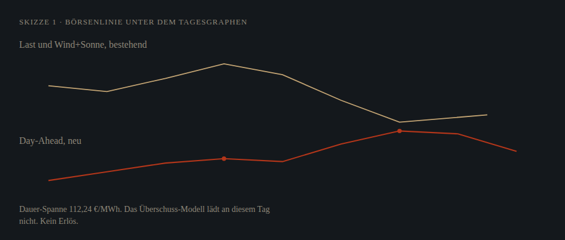
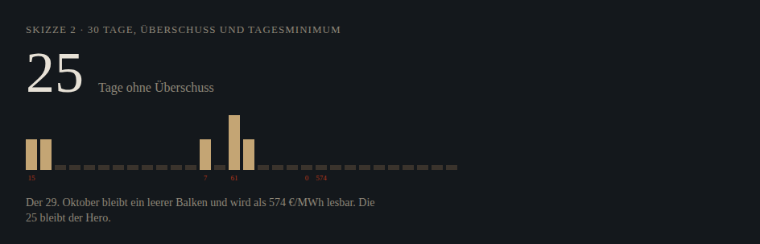
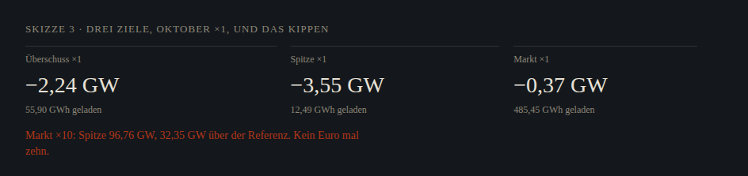

# Konzept — ein Satz über die leere Saison

Stand 9. November 2026. Grundlage ist [`AUDIT2.md`](AUDIT2.md), gelesen an der Live-Seite `dfb2f88`. Dieser Text beschreibt den Bogen und höchstens zehn Maßnahmen. Umgesetzt ist die erste. `/monat` und `/ort` bleiben im Layout unberührt, weil dort parallel gearbeitet wird.

## Der Satz

Im Herbst 2026 liegt der Wind-Solar-Überschuss an den meisten Tagen unter 0,05 GWh. Die Börse bleibt eine Spanne, das Preisniveau liegt hoch, die Abend-Restlast liegt weit über der heutigen Flotte. SpeicherPilot zeigt diese drei öffentlichen Zahlen am selben Tag, in GWh, GW und €/MWh, und sagt dazu, welches Ziel mehr Speicher bedienen würde. Ein Euro-Betrag bleibt die Modellschätzung bei ×1. Ab ×2 gibt es ihn nicht.

Die 25, der Tagesgraph, die Monatskurve und das dunkle Blatt bleiben. Die neue Figur setzt sich darunter, sie ersetzt den Hero nicht.

## Story

| Seite | Satz | Figur |
| --- | --- | --- |
| Start | 30 Tage, davon viele ohne Überschuss. Darunter der letzte Tag als Last, Wind und Sonne, und dieselbe Stunde als Börse. | Die 25 bleibt. Der Tagesgraph bleibt. Neu: die Viertelstundenlinie des Day-Ahead und ein Satz zur Dauer-Spanne. |
| Tag | Dieselbe Lesart für einen gewählten Tag. Die Auffälligkeit (am 8. November der Windanteil) bleibt die Überschrift. | Residuallast bleibt. Die Börsenlinie kommt direkt darunter, vor die Fußnoten. |
| Monat | Oktober vergleicht drei Ziele derselben Flotte. November sagt, null geladene Tage seien kein Urteil über den Speichernutzen, und verweist auf den Oktober, bis ein November-Lauf da ist. | Die Oktoberkurve bleibt. Kein neues Layout in diesem Schnitt. |
| Ort | Anschluss ist eine andere Frage als die deutsche Abendspitze. ÜNB-Karten zeigen Kapazität in MW-Klassen. Eine Reihe bis zur Mittelspannung fehlt. | Layout unberührt. Die Einordnung kommt später, nach der Lizenzprüfung. |
| Methodik | Jede neue Kennzahl mit Formel, Einheit, Unsicherheit und einer Gegenrechnung an einem echten Tag. | Abschnitt `#preis-fenster`. |

## Zehn Maßnahmen

Nutzen ist der Gewinn für die drei Leser (Projektierer, städtischer Netzplaner, Institut). Aufwand ist die Größe des Schnitts, nicht eine Dauer.

| # | Maßnahme | Nutzen | Aufwand | Jetzt |
| --- | --- | --- | --- | --- |
| 1 | Börsenlinie und Dauer-Spanne auf Start und Tag, Fußnote der Trockenstrecke nennt die Börse | Schließt die Saisonlücke, ohne den Hero anzufassen | Klein, Preise liegen schon in der Tagesreihe | Ja |
| 2 | Tagesminimum in €/MWh unter den 30 Überschuss-Balken | Würde Einheiten im GWh-Chart mischen. Der Preis bleibt in der Börsenlinie. | — | Nicht umsetzen |
| 3 | Ein Satz zu den drei Oktober-Zielen ×1 und zum Kippen der Marktfahrweise ab ×5, mit Link auf die bestehenden Läufe | Beantwortet „was mehr Speicher bringen würde“ in einem Blick | Klein als Satz, groß sobald das Monatslayout sich ändert | Skizze, Layout von `/monat` nicht anfassen |
| 4 | November-Lauf derselben drei Fahrweisen | Der aktuelle Monat hört auf, leer zu sein | Groß, und `/monat` ist parallel belegt | Später |
| 5 | Auf `/ort` die ÜNB-Kapazitätsklassen verlinkt einordnen: TransnetBW (Stand 05/2026, MW-Klassen je 380-kV-Umspannwerk) und 50Hertz (Stand 31.03.2026, Regelzone mit Hamburg). Erst nach Lizenzprüfung. Keine eigene Karte, kein Anspruch einer Mittelspannungsreihe | Der Netzplaner sieht, was öffentlich ist und wo die Reihe aufhört | Klein, sobald das Ort-Layout frei ist und die 50Hertz-Lizenz geklärt ist | Später |
| 6 | Die zwei Flottenstände sichtbar trennen: 4,64 GW / 8,14 GWh live, 4,58 GW / 8 GWh im Oktober-Lauf | Verhindert, dass zwei Stände als eine Zahl gelesen werden | Klein | Später, nicht im Monatslayout |
| 7 | Die neun Regelsätze aus Audit 2, Abschnitt 2, als feste Bausteine, sobald die Figur sie trägt | Insights ohne Laufzeit-KI | Mittel, Schwellen stehen | Nur Satz 1 und 2 berührt Maßnahme 1 |
| 8 | Preislinie in die Oktober-Restlastkurve | Last und Preis in einem Bild, wie die Referenz Energy-Charts | Mittel, und es ist `/monat` | Nicht in diesem Schnitt |
| 9 | Beiträge bleiben Lesestoff neben der Kette | Keiner für den roten Faden | Keiner | Nicht anfassen |
| 10 | Freie Megawatt-Eingabe, Euro mal Faktor, Share-Button, OG-Bild | Würde die Grenzen verletzen | — | Nicht vorgesehen |

## Top 1 — Börsenlinie

Die Linie ist der Day-Ahead DE-LU, eine Viertelstunde, ein Tag. Markiert sind die n günstigsten und die n teuersten Viertelstunden. Darunter ein Satz. Die Formel sitzt auf `/methodik#preis-fenster`.

Skizze, dunkel, unter dem bestehenden Tagesgraphen:

### Kennzahl Dauer-Spanne

Formel. Nutzbare Energie E = 0,8 × Nennenergie (Fenster 10–90 %). Stunden bei Nennleistung t = E / P. n = ⌊t / 0,25⌋. Dauer-Spanne = Mittel der n teuersten Viertelstunden minus Mittel der n günstigsten. Bei gleichem Preis bleibt die frühere Viertelstunde auf der günstigen Seite.

Einheit. €/MWh. Kein Euro-Erlös, keine Multiplikation mit ×2, ×5 oder ×10.

Unsicherheit. Statistik der Auktion, keine Fahrweise. Ob die günstigen Stunden vor den teuren liegen, ist ein zweiter Satz (`reihenfolge`). Der Wirkungsgrad 85 % ist nicht eingerechnet. Eine Viertelstunde kann den Mittelwert ziehen. n hängt am Flottenstand. Der 25. Oktober 2026 hat 100 Viertelstunden. Der Preisnehmer sieht keine Rückwirkung. Ab ×2 gibt es keinen Euro-Betrag. SMARD prüft die Lizenz der Großhandelspreise im Verfahren HEDWIG. Namensnennung: Bundesnetzagentur | SMARD.de, CC BY 4.0. EPEX wird nicht abgefragt.

Gegenrechnung, 8. November 2026, Flotte 4,64 GW / 8,14 GWh. E = 6,512 GWh, t = 1,403 h, n = 5.

- Günstig: 10:30 208,46 · 13:30 208,11 · 13:45 208,24 · 14:00 207,18 · 15:00 206,09. Summe 1.038,08. Mittel 207,616.
- Teuer: 17:45 321,50 · 18:30 319,69 · 18:45 318,15 · 19:30 319,93 · 20:00 320,00. Summe 1.599,27. Mittel 319,854.
- Dauer-Spanne 112,238 €/MWh. Volle Spanne desselben Tages 115,41 €/MWh.
- Reihenfolge ja: günstig bis 15:00, teuer ab 17:45.
- Energy-Charts und SMARD Filter 4169, Abruf 9. November 2026, dieselben Extreme 206,09 und 321,50.

Die Fußnote unter der 25 nennt an einem trockenen Tag die gerundete Börse (am 8. November 206–322 €/MWh) und sagt, dass keine Viertelstunde unter null lag. Sie verweist nicht mehr auf einen Monatslauf, den der November nicht hat. Das Euro-Zeichen ist der Börsenpreis, keine Modellschätzung.

## Top 2 — nicht umsetzen

Die Skizze setzt €/MWh unter die Überschuss-Balken. Das mischt Einheiten in einem GWh-Chart. Die Designabnahme lehnt das ab. Die 30-Tage-Balken bleiben bei GWh. Der Preis steht in der Börsenlinie, die Viertelstunde 17:15 des 29. Oktober mit 574,28 €/MWh eingeschlossen.

## Top 3 — drei Ziele, ein Satz

Nicht die Monatskurve. Ein Satz aus Zahlen, die der Oktober-Lauf schon zeigt, mit drei Links (`faktor=1`, Fahrweise Überschuss, Spitze, Markt) und einem zweiten Satz zur Sättigung:

> Oktober, Flotte 4,58 GW / 8 GWh, ×1. Überschuss senkt die Spitze um 2,24 GW und lädt 55,90 GWh. Spitze senken: −3,55 GW bei 12,49 GWh. Markt: −0,37 GW bei 485,45 GWh.
>
> Dieselbe Marktfahrweise hebt die Spitze ab ×5 (73,86 GW, 9,45 GW über der Referenz 64,41 GW) und bei ×10 auf 96,76 GW. Diese Spitze liegt am 21. Oktober um 14:00 Uhr: 50,96 GW Restlast plus 45,8 GW Laden in einer relativ günstigen Viertelstunde (201,29 €/MWh). Die Ladung wächst mit, 4.854,54 GWh. Die 485,45 GWh bei ×1 sind eine optimale Lösung, nicht die einzige. Das ist die Grenze des Preisnehmers. Kein Euro mal zehn.

Die Skizze ist die analytische Idee. Umgesetzt wird sie in einem eigenen Paket, nach diesem Schnitt. Die Schrift der Skizze ist nicht die Marke. Der Satz zu Markt ×10 gehört dann als Fußnote in gedämpfter Farbe, nicht als laute Warnzeile.

## Was dieser Schnitt nicht tut

Er ändert den Überschuss-Kern nicht. Er skaliert keine Euro. Er baut keine Deutschlandkarte und keinen Share-Button. Er lässt Hero, Tagesgraph, Monatskurve und das dunkle Blatt stehen.
