# Konzept-Audit 3 — die nächste Ebene

Stand: Montag, 9. November 2026, abends. Grundlage ist der Branch `cursor/paket3-award-alle-ebenen-048c`, also `main` mit PR #79 und dem offenen Paket 3 (PR #81). Gelesen wurden der Code, `doc/product-intent.md`, Audit 1 ([`../AUDIT.md`](../AUDIT.md)), Audit 2 ([`../konzept/AUDIT2.md`](../konzept/AUDIT2.md)), [`../konzept/KONZEPT.md`](../konzept/KONZEPT.md) und das Zielbild von Paket 3. Lokal lief ein Produktions-Build (`pnpm build`, `pnpm start`). Aufgenommen wurden sechs Routen in 1440 und 390 Pixel Breite, jeweils hell und dunkel, dazu die Live-Seite und fünf Benchmarks.

Dieses Dokument enthält keinen Code und ändert nichts an der App. Alle Ideen halten die harten Regeln ein. Was das Modell erweitern würde, ist als **Zukunft** markiert.

---

## Kurzfassung

**Die Seite ist schön, genau und ehrlich. Ihr Problem liegt im Rahmen, nicht in der Form.** Die Hauptzahl, der Wind-Solar-Überschuss, ist eine Jahreszeit-Zahl. In den letzten zwölf Monaten hatten November bis März zusammen 6 Überschusstage, April bis September 135 (Abschnitt 2). Damit meldet die Startseite fünf Monate im Jahr „nichts“. Gleichzeitig zeigen die öffentlichen Daten, dass die echten Speicher an genau diesen Tagen arbeiten: Am 8. November, an dem das Modell „nichts zu laden“ meldet, haben die deutschen Pumpspeicher laut Energy-Charts 30,0 GWh gepumpt und abends 14,6 GWh zurückgegeben.

Die drei stärksten neuen Ideen:

1. **Die echten Speicher neben dem Modell.** Die Pumpspeicher-Reihe liegt schon in derselben Energy-Charts-Antwort, die die Seite heute lädt. Sie zeigt das beobachtete Verhalten der vorhandenen Speicher.
2. **Das Speicherjahr.** 365 Tage mal 96 Viertelstunden als Bild. Die „25“ wird damit zur Jahreszeit statt zum Alarm. Die Skizze unten ist mit echten Daten gerechnet.
3. **Maßstab in einem Satz.** Die ganze heutige Flotte (8,14 GWh) würde Deutschland am 8. November rund 9 Minuten versorgen. Diese Zahl versteht jeder sofort.

Empfohlene Startseite: **Konzept A, „Das Speicherjahr“**. Die 25 bleibt die große Zahl, rückt aber in den Jahresrahmen. Darunter folgt der gestrige Tag in drei Linsen.

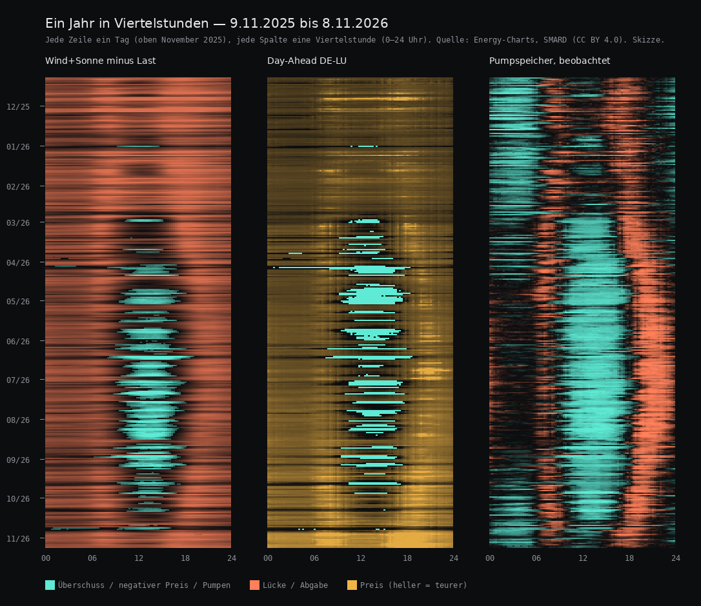

*Skizze, keine App-Grafik. Links Wind+Sonne minus Last, Mitte Day-Ahead DE-LU, rechts Pumpspeicher (Pumpen mint, Abgabe koralle). 9.11.2025 bis 8.11.2026, Energy-Charts `total_power` und `price`, CC BY 4.0, Bundesnetzagentur | SMARD.de. Rechenweg im [Anhang](#anhang-daten-und-gegenrechnung).*

---

## 1. Was ist SpeicherPilot eigentlich?

**Heute** ist SpeicherPilot drei Dinge zugleich: ein Tagesbericht (Start, Tag), ein Modelllabor (Monat mit ×1 bis ×10 und drei Fahrweisen) und ein Anschlussrechner (Ort). Die Navigation ordnet nach Zeitmaßstab (Tag, Monat) und nach Raum (Ort). Sie ordnet nicht nach der Frage, mit der jemand kommt.

**Was es sein kann**, in einem Satz:

> **SpeicherPilot zeigt jeden Tag, was Batteriespeicher in Deutschland gestern getan hätten — für das Stromsystem, für den Markt und für das Netz am Ort — und warum diese drei Antworten verschieden sind.**

**Die eine Frage, die kein anderes Werkzeug beantwortet:** *„Was hätte Speicher gestern geändert, und für wen?“*

- Energy-Charts zeigt, was passiert ist. Es zeigt nicht, was ein Speicher getan hätte.
- Battery Charts zeigt, wie groß die Flotte ist. Es zeigt nicht, was sie tut.
- Modo Energy rechnet Erlöse, aber kostenpflichtig, auf Englisch und ohne Netzsicht.
- SMARD zeigt den Markt. Es zeigt kein Modell.

SpeicherPilot ist das einzige offene, deutsche, tägliche **Was-wäre-wenn** mit offengelegtem Modell. Das ist der Kern. Alles Weitere sollte ihm dienen.

**Wo der rote Faden schwach ist:**

| Bruchstelle | Beleg | Folge |
| --- | --- | --- |
| Die Hauptzahl gehört nur zur System-Linse und hängt an der Jahreszeit | 25 von 30 Tagen ohne Überschuss. November bis März: 0 bis 3 Überschusstage je Monat | Von November bis März meldet die Seite „nichts“, obwohl Markt und Netz Geschichten haben |
| Die drei Ziele stecken in einem Umschalter | Der Drei-Ziele-Vergleich steht auf `/monat/2026-10` hinter Insights, nur für Oktober | Die tiefste Erkenntnis der Seite (Markt, System und Netz wollen Verschiedenes) bleibt ein Spezialwissen |
| Drei Flottenstände | Start 4,64 GW / 8,14 GWh. Oktober-Lauf 4,58 GW / 8 GWh. `/tag/2026-10-29` und Insight auf `/ort`: 4,52 GW / 7,86 GWh (Snapshot 21.10.) | Ein aufmerksamer Leser zweifelt an allen Zahlen |
| Ort steht neben dem Tag, nicht unter ihm | Ladepark-Beispiel, SimBench-Mustertag 2016 mit Preisen von 2026 | Der Sprung von der deutschen Abendspitze zum Anschluss erklärt sich nicht |
| Dieselben Insights auf fünf Seiten | Gleiche vier Sätze auf Start, Monat, Ort, Beiträge, Tag | Sie lesen sich wie ein Anhang, nicht wie Befunde |

---

## 2. Der Aha-Befund: die Seite erzählt eine Jahreszeit als Leere

Nachgerechnet aus Energy-Charts (`total_power`, Wind on- und offshore plus Solar gegen `Load (incl. self-consumption)`, Schwelle 0,05 GWh, gleiche Definition wie `/methodik`). Die Monatszählung stimmt mit `data/surplus-months.json` überein.

| Monat | Überschusstage | Überschuss (GWh) |
| --- | --- | --- |
| Nov 25 (ab 9.) | 0 von 22 | 0,0 |
| Dez 25 | 0 von 31 | 0,0 |
| Jan 26 | 1 von 31 | 26,8 |
| Feb 26 | 2 von 28 | 69,1 |
| Mär 26 | 3 von 31 | 40,6 |
| Apr 26 | 16 von 30 | 496,5 |
| Mai 26 | 19 von 31 | 628,6 |
| Jun 26 | 25 von 30 | 956,8 |
| Jul 26 | 29 von 31 | 1.353,2 |
| Aug 26 | 25 von 31 | 1.388,0 |
| Sep 26 | 21 von 30 | 598,5 |
| Okt 26 | 8 von 31 | 132,9 |
| Nov 26 (bis 8.) | 0 von 8 | 0,0 |

Und was die echten Speicher taten (Pumpspeicher, Energy-Charts, beobachtet):

- **8. November 2026**: gepumpt 30,0 GWh, vor allem 03 bis 05 Uhr und 10 bis 14 Uhr (bis 2,9 GW). Abgegeben 14,6 GWh, Spitze 18 Uhr mit 2,5 GW. Das Überschuss-Modell lud an diesem Tag 0,0 GWh.
- **Ganzes Jahr**: 11,8 TWh gepumpt, 9,2 TWh abgegeben.
- **Die Skizze oben zeigt den Wechsel**: Im Winter pumpen die Pumpspeicher nachts, im Sommer mittags. Ihr Rhythmus folgt dem Preis, und der Preis folgt der Sonne.

**Das ist der Aha-Moment, den die Seite heute verschenkt:** Speicher arbeiten das ganze Jahr. Im Sommer laden sie Sonne, im Winter verschieben sie Nachtstrom in den Abend. Das Überschuss-Modell sieht nur die erste Hälfte, und das ist korrekt so. Die Seite sollte aber sagen, dass es eine zweite Hälfte gibt.

Was erhalten bleibt: Das Überschuss-Modell, die 25 und der Rechenkern bleiben unverändert. Neu ist nur der Rahmen.

---

## 3. Zielgruppen: ihre echte Aufgabe und was ihnen fehlt

| Wer | Echte Aufgabe | Was sie heute vermissen würden | Idee unten |
| --- | --- | --- | --- |
| **Speicherprojektierer** | Standort und Größe begründen, Bank und Gemeinderat überzeugen, Saison und Spannen einschätzen | Eine lange Reihe (Jahre, nicht 30 Tage). Ein offener, nachrechenbarer Day-Ahead-Referenzwert. Wo Speicher und Erzeugung räumlich liegen. Den eigenen Lastgang | 1, 2, 7, 8, 12 |
| **Netzplaner Stadtwerk / VNB** | Anschlussanfragen bewerten, Engpässe vorhersehen, Fragen zu „netzdienlich“ beantworten | Gleichzeitigkeit: Was passiert, wenn alle Speicher zur selben Viertelstunde laden? Regionale statt deutscher Sicht. Eigenen Lastgang prüfen | 3, 6, 12 |
| **ÜNB** | Systembilanz, Regelzonen, Abendrampe | Regelzonen getrennt (50Hertz, TenneT, Amprion, TransnetBW). Beobachtete Speicher statt nur Modell | 2, 6 |
| **Forschung** | Nachrechnen, zitieren, vergleichen | Datendownload je Figur, lange Reihen, ein Vergleichstag-Werkzeug, eine stabile Index-Reihe | 1, 8, 10, 13 |
| **Politik, Journalismus** | Einordnen: Sind Speicher die Lösung? Wie groß ist groß? | Maßstab in Alltagseinheiten. Der Trichter aus Anfragen, Zusagen und Bestand. Ein Satz, der hält | 4, 3, 1 |
| **Interessierte Öffentlichkeit** | Verstehen, warum Strom abends teuer ist und was Batterien damit zu tun haben | Ein Bild ohne Fachwort. „Morgen“ statt nur „gestern“ | 1, 4, 5 |

---

## 4. Benchmark: Was die Besten unvergesslich macht

| Vorbild | Was hängen bleibt | Welches Muster uns fehlt |
| --- | --- | --- |
| [Energy-Charts](https://energy-charts.info) | Alles ist da, jede Reihe seit Jahren, ein festes Rahmenformat | **Lange Zeit.** SpeicherPilot denkt in 30 Tagen. Wir sollten die Tiefe nicht kopieren, aber ein Jahr als Hintergrund zeigen. |
| [Electricity Maps](https://app.electricitymaps.com) | Eine Live-Zahl, eine Farbe, die etwas bedeutet (CO₂) | **Farbe = Bedeutung.** Bei uns steht Orange für Akzent, Preis und Abendspitze zugleich. |
| [Our World in Data](https://ourworldindata.org) | Jede Grafik hat Tabelle, Quellen und Download. Der Titel ist der Befund. | **Daten zum Mitnehmen** (CSV je Figur). Kein Share-Button, sondern Daten. |
| [Modo Energy](https://modoenergy.com/research) | Der Index als Produkt: eine Zahl pro Tag, die ein ganzer Markt zitiert | **Eine Referenzreihe.** Modo ist kostenpflichtig. Ein offener, transparenter Day-Ahead-Wert für Deutschland fehlt. |
| NYT / FT / Bloomberg | Annotation zuerst, „Sie sind hier“, kleine Vielfache statt Umschalter | **Small multiples.** ×1, ×2, ×5, ×10 sind heute Knöpfe. Als vier kleine Kurven nebeneinander sieht man sie auf einen Blick. |
| [The Pudding](https://pudding.cool) | Eine Idee pro Stück, eine Form, die man wiedererkennt | **Eine Signatur-Form.** Bei uns gibt es Riesenzahl und Balken, aber keine Form, an der man die Seite erkennt. |
| Awwwards / Information is Beautiful | Handwerk im Detail, ein einziges visuelles Motiv durchgezogen | **Ein Motiv**: Vorschlag ist der Viertelstunden-Strichcode, siehe Abschnitt 7. |

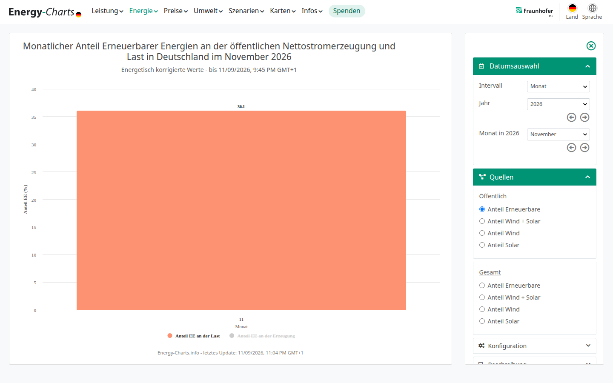
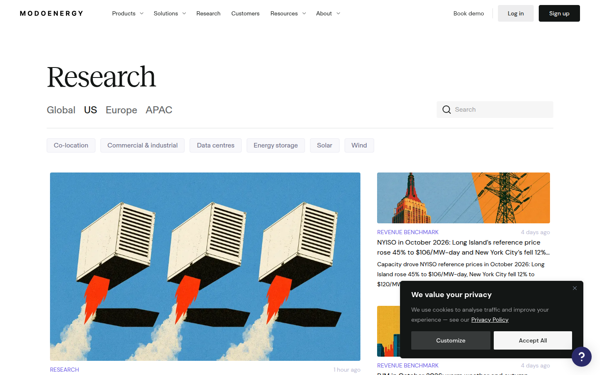
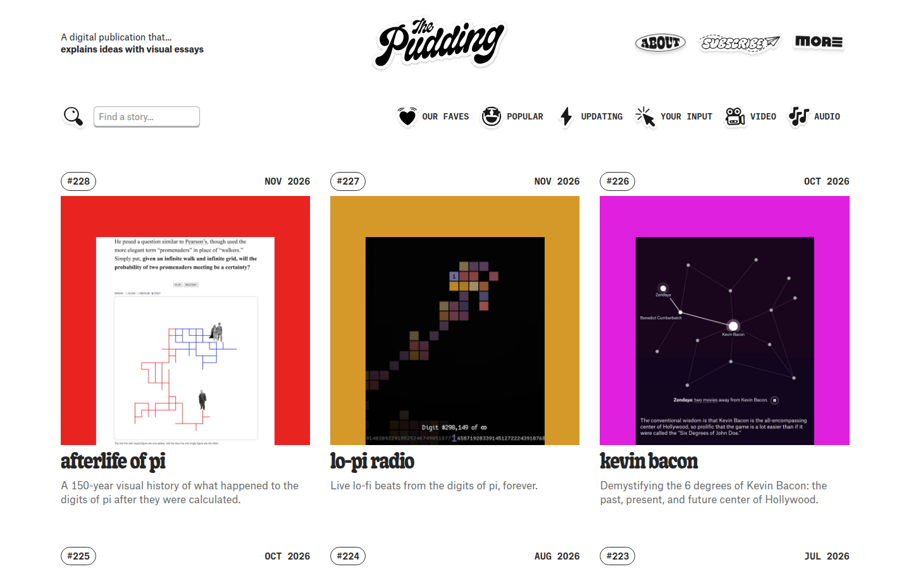

Electricity Maps und FT blockierten den Headless-Browser (Cloudflare). Die Einordnung dazu stammt aus den öffentlichen Produkten, nicht aus einem Screenshot.

---

## 5. Neue Ideen

Aufwand ist die Größe des Eingriffs: **S** (eine Figur, vorhandene Daten), **M** (neue Datenstufe oder neue Route), **L** (neue Datenquelle mit Aufbereitung und eigenem Kapitel). Jede Idee nennt, was erhalten bleibt.

### 1 · Das Speicherjahr — der Viertelstunden-Strichcode

- **Was:** Ein Bild aus 365 Zeilen mal 96 Viertelstunden. Links Wind+Sonne gegen Last, daneben der Preis. Die heutige Zeile ist markiert, die 30 Tage der Startseite sind als Klammer eingezeichnet. Dazu eine neue Route `/jahr`, auf der Startseite eine schmale Fassung.
- **Warum Aha:** Man sieht in einer Sekunde, dass der Überschuss eine Insel im Sommer-Mittag ist und dass der Herbst jedes Jahr so aussieht. Die 25 wird damit vom Alarm zur Jahreszeit.
- **Für wen:** alle. Vor allem Projektierer (Saisonprofil) und Öffentlichkeit.
- **Daten:** Energy-Charts `total_power` und `price`, ein Jahr in einer Abfrage, etwa 5 MB, statisch einmal täglich vorgerechnet.
- **Aufwand:** M. Die Datenstufe gibt es ähnlich schon (`surplus-months.json`).
- **Risiko:** Farbskalen können täuschen (Sättigung). Ein Jahr ist kein Klima. Die Zeitumstellung erzeugt Tage mit 92 oder 100 Viertelstunden.
- **Bleibt:** die 25, die 30-Tage-Balken (als Ausschnitt des Jahres) und der Überschuss-Kern.

### 2 · Die echten Speicher — beobachtet neben dem Modell

- **Was:** Im Tagesgraphen eine dritte, dünne Spur: Pumpspeicher, beobachtet (Pumpen unter null, Abgabe über null). Daneben die Modellspur der Batterieflotte. Dazu der Satz: „Gestern hat das Modell nichts geladen. Die Pumpspeicher haben 30,0 GWh gepumpt und abends 14,6 GWh abgegeben.“
- **Warum Aha:** An Tagen ohne Überschuss zeigt die Seite nicht mehr „nichts“, sondern was echte Speicher tun. Das Modell wird an der Wirklichkeit messbar. Die Pumpspeicher folgen sichtbar dem Preis.
- **Für wen:** Forschung, ÜNB, Journalismus, Projektierer.
- **Daten:** Energy-Charts `total_power`, Reihen `Hydro pumped storage` und `Hydro pumped storage consumption`. Sie liegen in derselben Antwort, die die Seite heute lädt.
- **Aufwand:** S bis M.
- **Risiko:** Pumpspeicher sind keine Batterien (andere Größe, andere Speicherdauer, andere Marktrollen). Die Zuordnung ausländischer Anlagen zur deutschen Reihe ist zu prüfen. Die Reihe darf nur als „beobachtet“ erscheinen und nie als Modell-Ersatz. Eine Batterie-Reihe veröffentlicht Energy-Charts für Deutschland derzeit nicht. Sobald es eine gibt, gehört sie hierher.
- **Bleibt:** das Überschuss-Modell, unverändert.

### 3 · Drei Linsen — „Wem dient der Speicher?“ als Rückgrat

- **Was:** Jeder Tag wird in drei festen Linsen gelesen, immer in derselben Reihenfolge und Farbe: **System** (Überschuss, heute die 25), **Markt** (Day-Ahead-Spanne und -Niveau), **Netz** (Abendspitze gegen Flotte, lokal: Anschluss). Der Drei-Ziele-Vergleich aus Paket 3 wird dazu das Herz von `/monat`. Seine schärfste Zahl bekommt eine eigene Figur, **„Die Herde“**: Markt ×10 hebt die Spitze auf 96,76 GW am 21. Oktober um 14:00 Uhr (50,96 GW Restlast plus 45,8 GW Laden bei 201,29 €/MWh).
- **Warum Aha:** Die Debatte 2026 dreht sich um „netzdienlich“, Baukostenzuschuss und flexible Anschlüsse. Diese Seite kann als einzige zeigen, dass dieselbe Batterie je nach Ziel die Spitze senkt oder eine neue erzeugt.
- **Für wen:** VNB, ÜNB, Politik. Projektierer sehen und Netzbetreiber sehen getrennt, aber nebeneinander.
- **Daten:** vorhanden (Oktober-Lauf). Für weitere Monate braucht es den November-Lauf.
- **Aufwand:** M (Struktur, Texte, Figur). Der November-Lauf ist L.
- **Risiko:** Der Preisnehmer überzeichnet die Herde bei ×10, weil echte Preise sich anpassen würden. Das muss in den Satz und darf nicht in eine Fußnote rutschen. Euro dürfen nicht hinzukommen.
- **Bleibt:** die Fahrweisen-Logik, ×1 bis ×10 in GWh und GW, kein Euro ab ×2.

### 4 · Maßstab — „9 Minuten Deutschland“ und der Trichter

- **Was:** Eine ruhige Zeile mit Maßstabsfigur. *Die ganze heutige Flotte (8,14 GWh) würde Deutschland am 8. November etwa 9 Minuten versorgen. ×10 wären etwa 1,5 Stunden.* Darunter ein Trichter aus drei getrennten Balken mit Stichtag: rund 400 GW angefragt (2024), rund 25 GW zugesagt (2024), 4,64 GW in Betrieb (Battery Charts, Stand heute).
- **Warum Aha:** „8,14 GWh“ sagt Laien nichts, „9 Minuten“ versteht jeder. Der Trichter erklärt in einem Bild, warum der Anschluss der Engpass ist und nicht die Batterie.
- **Für wen:** Politik, Journalismus, Öffentlichkeit. Für Projektierer ist es Gesprächsmaterial.
- **Daten:** Verbrauch des Tages (vorhanden). BNetzA-Pressemitteilung vom 12.11.2025 und SMARD (Anfragen, Zusagen). Battery Charts für den Bestand.
- **Aufwand:** S.
- **Risiko:** Die drei Balken haben verschiedene Stichtage und Abgrenzungen (die BNetzA nennt für den Bestand 2,3 GW, Battery Charts 4,64 GW). Sie dürfen nicht als Rechnung gelesen werden und brauchen einzelne Etiketten. Mehrfachanfragen blähen die 400 GW auf, das muss im Satz stehen. „9 Minuten“ ist eine Größenübersetzung und kein Versorgungsszenario.
- **Bleibt:** alles. Die Maßstabszeile ist neu, die Seite verliert nichts.

### 5 · Morgen — der Tag, dessen Preis schon feststeht

- **Was:** Eine Ansicht `/morgen`. Der Day-Ahead-Preis für morgen steht nach der Auktion am Mittag fest. Gezeigt werden die Preiskurve für morgen, die günstigsten und teuersten Viertelstunden und der Fahrplan, den das Modell ×1 als Preisnehmer daraus machen würde, in GWh, ohne Euro-Prognose.
- **Warum Aha:** Die Seite blickt dann auch nach vorn. Sie wird zur täglichen Gewohnheit („Was steht morgen an?“) und nicht nur zum Rückblick.
- **Für wen:** Projektierer, Öffentlichkeit, Journalismus.
- **Daten:** Energy-Charts `price` für den Folgetag. Wind- und Solarprognosen nur, wenn sie öffentlich und lizenzklar sind. Sonst bleibt es beim Preis.
- **Aufwand:** M.
- **Risiko:** Das darf nicht wie Handelsberatung wirken. Ohne Prognose für die Last ist keine Überschuss-Aussage für morgen möglich. Das muss klar dastehen.
- **Bleibt:** der Rückblick als Hauptsache. „Morgen“ ist eine Tür daneben.

### 6 · Vier Deutschlands — die Regelzonen

- **Was:** Derselbe Überschuss-Strichcode, getrennt nach 50Hertz, TenneT, Amprion und TransnetBW. Dazu der Satz: „An X der 25 Tage ohne deutschen Überschuss hatte die Regelzone 50Hertz trotzdem Viertelstunden mit Überschuss.“ Das ist eine Hypothese und muss erst gerechnet werden.
- **Warum Aha:** Deutschland ist keine Kupferplatte. Der Norden hat Überschuss, wenn der Bund keinen hat. Das ist die Brücke von der nationalen Zahl zum Ort.
- **Für wen:** ÜNB, VNB, Projektierer (Standortwahl).
- **Daten:** SMARD, Erzeugung und Last je Regelzone, Viertelstunde, CC BY 4.0.
- **Aufwand:** M.
- **Risiko:** Regelzone ist nicht Netzgebiet, und Flüsse zwischen den Zonen fehlen. Lastreihen je Zone sind teils nicht ganz vollständig. Das ist eine Lesehilfe und keine Netzwirkung.
- **Bleibt:** das nationale Modell als Hauptzahl.

### 7 · Speicher-Atlas — wo Speicher entstehen und wo Strom entsteht

- **Was:** Ein Kachel-Kartogramm der Landkreise (gleich große Kacheln, keine Satellitenkarte). Pro Kachel stehen Speicher in Betrieb und in Planung (MWh) neben Wind- und PV-Leistung (MW), alles aus dem MaStR. Die ÜNB-Kapazitätskarten werden verlinkt, nicht nachgebaut.
- **Warum Aha:** Man sieht, ob Speicher dort entstehen, wo der Überschuss entsteht, oder dort, wo der Anschluss frei war.
- **Für wen:** Projektierer, VNB, Politik.
- **Daten:** MaStR (öffentlicher Gesamtdatenexport der BNetzA), Battery Charts als Abgleich.
- **Aufwand:** L.
- **Risiko:** MaStR-Daten verzögern sich, und die Planungsdaten sind unvollständig. Freie Anschlusskapazität darf nicht erfunden werden. Die Lücke bis zur Mittelspannung bleibt benannt (wie in Audit 2).
- **Bleibt:** `/ort` mit den zwei Perspektiven. Der Atlas ist der Raum darüber.

### 8 · Day-Ahead-Referenzwert ×1 — ein offener Index

- **Was:** Eine Zahl je Tag: Was eine Referenzbatterie (2 Stunden, ein Zyklus, Round-Trip 85 %, SoC 10–90 %, Preisnehmer, nur Day-Ahead) an diesem Tag modellhaft hätte verdienen können, in €/MW. Dazu die Reihe seit 2019. Als **Modellschätzung** gekennzeichnet, nur ×1, nie skaliert.
- **Warum Aha:** Das ist ein offener, deutscher, nachrechenbarer Gegenpol zu kostenpflichtigen Indizes. Die lange Reihe zeigt, wie sich die Spannen entwickeln, während die Flotte wächst.
- **Für wen:** Projektierer, Forschung, Journalismus.
- **Daten:** Energy-Charts `price` (DE-LU), Battery Charts für die Flottenreihe.
- **Aufwand:** M. Der Rechenkern existiert (`simulateBessDispatch`).
- **Risiko:** Hoch. Der Wert kann als Erlösversprechen gelesen werden. Weil Intraday und Regelleistung fehlen, liegt er systematisch zu niedrig. Die SMARD-Lizenz für Großhandelspreise wird im Verfahren HEDWIG geprüft. Deshalb nur mit klarer Kennzeichnung und nur ×1. Euro für die nationale Flotte bleiben ausgeschlossen.
- **Bleibt:** keine Euro auf Start und Monat, kein Euro ab ×2.

### 9 · Die Partitur des Tages — eine Zeitleiste für alles

- **Was:** Ein Regler für die Uhrzeit, der alle Spuren eines Tages zugleich bewegt: Restlast, Preis, Speicherstand im Modell, Pumpspeicher beobachtet, auf `/ort` auch die Auslastung am Anschluss. Eine Zeitachse für 00–24 Uhr auf jeder Seite.
- **Warum Aha:** Die drei Linsen werden zu einem Bild. Man „spielt“ den Tag ab und sieht, wie Preis, Lücke und Speicher zusammenhängen.
- **Für wen:** alle. Interaktion für Neugierige, für Profis ein präzises Ablesewerkzeug.
- **Daten:** vorhanden.
- **Aufwand:** M.
- **Risiko:** Mobil eng. Wenn der Regler zu verspielt wirkt, leidet die Bedienbarkeit. Er muss per Tastatur bedienbar sein und `prefers-reduced-motion` beachten.
- **Bleibt:** der Tagesgraph mit Annotation 58,5 GW als Standbild, der Regler ist optional.

### 10 · Zwillingstag — „Dieser Tag ähnelt …“

- **Was:** Eine feste Regel sucht im Archiv den Tag mit der ähnlichsten Restlastkurve (zum Beispiel kleinster Abstand der 96 Werte) und stellt beide als kleine Vielfache nebeneinander: „Der 8.11.2026 ähnelt dem 21.11.2025. Damals lag die Spanne bei …“
- **Warum Aha:** Ein Tag bekommt Geschichte. Man sieht, was sich in einem Jahr verändert hat, etwa beim Preis oder bei der Flotte.
- **Für wen:** Forschung, Journalismus.
- **Daten:** vorhanden, sobald das Jahr aus Idee 1 vorliegt.
- **Aufwand:** S nach Idee 1.
- **Risiko:** Ähnlichkeit ist eine Definitionsfrage. Die Regel gehört nach `/methodik`. Es läuft keine KI zur Laufzeit.
- **Bleibt:** die Auffälligkeit als Überschrift.

### 11 · Zukunft · Was Speicher heute wirklich verdienen (Regelleistung)

- **Was, als Zukunft markiert:** Die beobachteten Preise für Regelleistung (FCR, aFRR) von regelleistung.net als Marktkontext neben dem Day-Ahead. Eine spätere Modellerweiterung würde den Erlös aus mehreren Märkten zusammenrechnen.
- **Warum Aha:** Die Seite könnte zeigen, wie ein Markt sich sättigt: Mit wachsender Batterieflotte fallen die FCR-Preise. Das ist Kannibalisierung, beobachtet statt modelliert.
- **Für wen:** Projektierer, Forschung.
- **Daten:** regelleistung.net (öffentliche Ausschreibungsergebnisse).
- **Aufwand:** L.
- **Risiko:** Das sprengt das heutige Modell (nur Day-Ahead). Deshalb zuerst nur als Beobachtung ohne Modell-Euro.
- **Bleibt:** das Modell nur mit Day-Ahead, bis zur ausdrücklichen Entscheidung.

### 12 · Lastgang-Labor — der eigene Anschluss, lokal im Browser

- **Was:** Wer einen Lastgang als CSV in den Browser zieht (Viertelstunden, kW), sieht ihn in derselben Figur wie den Beispielanschluss auf `/ort`, mit derselben Ampel und demselben Badge als Schätzung. Die Datei verlässt den Rechner nicht.
- **Warum Aha:** Aus dem Beispiel wird der eigene Fall. Das ist für Stadtwerke und Projektierer der Schritt vom Lesen zum Benutzen.
- **Für wen:** VNB-Netzplaner, Projektierer. Beide Perspektiven bleiben getrennt.
- **Daten:** die eigene Datei. Kein Server, kein Speichern.
- **Aufwand:** M. `planSite` gibt es schon.
- **Risiko:** Datenschutz-Erwartung. „Lokal“ muss sichtbar und prüfbar sein. Fehlformate brauchen eine Zod-Prüfung. Die Ergebnisse sind keine Netzprüfung.
- **Bleibt:** die Beispiele als Einstieg.

### 13 · Daten zur Figur — CSV statt Share

- **Was:** Unter jeder Figur ein unscheinbarer Link „Daten (CSV)“ mit genau den Zahlen der Figur, Quelle und Lizenzzeile.
- **Warum Aha:** Für die Forschung ist das der Unterschied zwischen Ansehen und Zitieren. Es entspricht dem Muster von Our World in Data, ohne Share-Button.
- **Für wen:** Forschung, Journalismus.
- **Daten:** vorhanden. Lizenz CC BY 4.0 mit Namensnennung.
- **Aufwand:** S.
- **Risiko:** Lizenzhinweis HEDWIG bei den Preisen. Die Modellwerte müssen als Modell gekennzeichnet sein.
- **Bleibt:** alles.

### Übersicht: Aha gegen Aufwand

| # | Idee | Aha | Aufwand | Risiko |
| --- | --- | --- | --- | --- |
| 2 | Echte Speicher beobachtet | sehr hoch | S–M | mittel |
| 1 | Speicherjahr | sehr hoch | M | gering |
| 4 | Maßstab und Trichter | hoch | S | mittel |
| 3 | Drei Linsen / Herde | sehr hoch | M (L mit November-Lauf) | mittel |
| 13 | CSV je Figur | mittel | S | gering |
| 9 | Partitur | hoch | M | mittel |
| 10 | Zwillingstag | mittel | S nach 1 | gering |
| 6 | Vier Regelzonen | hoch | M | mittel |
| 5 | Morgen | hoch | M | mittel |
| 12 | Lastgang-Labor | hoch für Profis | M | mittel |
| 8 | Day-Ahead-Index ×1 | hoch | M | hoch |
| 7 | Speicher-Atlas | hoch | L | mittel |
| 11 | Regelleistung (Zukunft) | mittel | L | hoch |

---

## 6. Drei Konzepte für die Startseite

Alle drei behalten das dunkle Blatt, die Typografie und den Tagesgraphen. Die Skizzen zeigen den ersten Bildschirm bei 1440 Pixeln.

### A · Das Speicherjahr (Empfehlung)

Die 25 bleibt die große Zahl. Rechts stehen statt 30 Balken die letzten zwölf Monate als schmaler Strichcode, mit einer Klammer um die 30 Tage. Die Überschrift ordnet ein, statt zu alarmieren. Darunter steht eine Zeile mit drei Linsen für gestern.

```
┌──────────────────────────────────────────────────────────────────────────────┐
│ SpeicherPilot        Start  Tag  Monat  Jahr  Ort  Methodik  Beiträge     ☼  │
├──────────────────────────────────────────────────────────────────────────────┤
│ START · SO, 08.11.2026 · DATENSTAND 06:00                                    │
│ 30 Tage, 25 ohne Überschuss. So beginnt jeder Winter.                        │
│ Von November bis März gab es zuletzt 6 Überschusstage.                       │
│                                                     Nov ▏░░░░░░░░░░░░░░      │
│   ██████  ██████                                    Jan ▏░░░░░░░▒░░░░░░      │
│   ██      ██       Tage                             Mär ▏░░░░░▒▓▒░░░░░░      │
│   ██████  ██████                                    Mai ▏░░░▒▓███▓▒░░░░      │
│       ██      ██                                    Jul ▏░░▒▓█████▓▒░░░      │
│   ██████  ██████                                    Sep ▏░░░▒▓███▒░░░░░      │
│   OHNE TAGES-ÜBERSCHUSS (30 TAGE)                 ┌ Okt ▏░░░░░▒▒░░░░░░      │
│                                                   └ Nov ▏░░░░░░░░░░░░░░ ◀ heute
│                                                         00    12    24       │
├──────────────────────────────────────────────────────────────────────────────┤
│ GESTERN IN DREI LINSEN                                                       │
│ SYSTEM            │ MARKT                   │ NETZ                           │
│ 0,0 GWh Überschuss│ 206–322 €/MWh, Spanne   │ 58,5 GW Abendspitze            │
│ Modell lädt nicht │ 115 · kein Wert unter 0 │ Flotte 4,64 GW = 7,9 %         │
│ Pumpspeicher:     │ ▁▁▁▁▁▁▁▁▁▁▂▅▇▇▅▃▂▁      │ ▁▂▃▄▅▆▇█▇▆▅                    │
│ 30,0 GWh gepumpt  │                         │                                │
└──────────────────────────────────────────────────────────────────────────────┘
```

- **Erhalt:** die 25 als Riesenzahl, der Kicker, die Links, der Tagesgraph direkt darunter.
- **Neu:** der Jahres-Strichcode statt der 30 Balken (die 30 Tage sind darin geklammert), die Linsen-Zeile und der Navigationspunkt „Jahr“.
- **Warum Empfehlung:** Das Konzept löst das Grundproblem, die Leere-Meldung im Winter, ohne die Form zu opfern, die Phillipp mag. Es führt zudem ein Motiv ein, an dem man die Seite wiedererkennt.

### B · Drei Linsen

Kein Hero mehr mit einer Zahl. Gestern erscheint als drei gleich große Spalten, jede mit eigener großer Zahl und Mini-Kurve. Die Überschrift wechselt je nach Linse, in der der Tag am auffälligsten war.

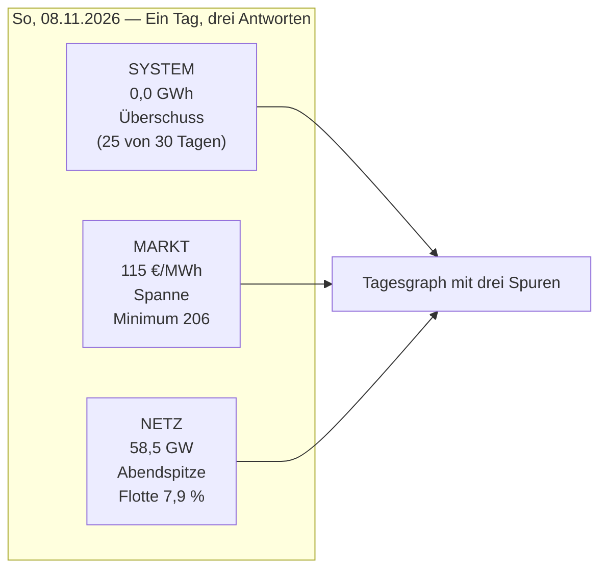

- **Erhalt:** Tagesgraph, Insights-Regeln (sie wählen die Linse), Methodik.
- **Verlust:** die eine große 25 als Poster.
- **Stärke:** Das Konzept ist am ehrlichsten zur Zielkonflikt-These und stark für Netzplaner.
- **Schwäche:** Drei Zahlen konkurrieren, und Audit 1 hat aus gutem Grund auf eine Display-Zahl reduziert.

### C · Der Maßstab (Erzählung)

Eine Pudding-artige Scroll-Erzählung, die mit einem Satz beginnt und Schritt für Schritt skaliert.

```
┌──────────────────────────────────────────────────────────────────────────────┐
│                                                                              │
│      Alle Großspeicher Deutschlands zusammen                                 │
│      würden das Land gestern                                                 │
│                                                                              │
│                         9 Minuten                                            │
│                                                                              │
│      lang versorgen.                                                         │
│                                                                              │
│      ▮  8,14 GWh Flotte                                                      │
│      ████████████████████████████████████████████  1.275 GWh Verbrauch       │
│                                                                              │
│      ↓  Und doch haben Speicher gestern gearbeitet.                          │
└──────────────────────────────────────────────────────────────────────────────┘
   Scroll 2: Abendspitze 58,5 GW gegen 4,64 GW · Scroll 3: Trichter 400 → 25 → 4,64 GW
   Scroll 4: Die Herde (×10 Markt, 96,76 GW um 14:00) · Scroll 5: Tür zu Tag und Ort
```

- **Erhalt:** Daten, Modell, Unterseiten.
- **Verlust:** der tägliche Charakter. Die Erzählung ist an jedem Tag gleich, nur die Zahlen wechseln.
- **Stärke:** der größte Aha-Effekt für Laien.
- **Schwäche:** Für Profis ist das ein Umweg. Die Gefahr einer Kampagnenseite ist groß.
- **Besser geeignet:** als ein Beitrag unter `/beitraege` statt als Startseite.

**Empfehlung:** A als Startseite. Die Linsen-Zeile aus B wird das erste Kapitel unter dem Hero, C wird ein Beitrag. So bleibt die Seite ein täglicher Bericht und gewinnt einen Jahresrahmen.

---

## 7. Design-Sprache: was unverwechselbar wäre

Arbeitstitel: **Leitwarte trifft Zeitung.** Präzise wie ein Messinstrument und ruhig wie eine gute Grafikseite.

**Motiv: der Viertelstunden-Strichcode.** Die Viertelstunde ist das Atom dieser Seite: 96 Striche ergeben einen Tag, 30 Zeilen einen Monat, 365 Zeilen ein Jahr. Dieselbe Form trägt Start, Tag, Monat und Jahr. Man erkennt sie wieder, wie man die Streifen von Ed Hawkins wiedererkennt.

**Typografie.**
- Space Grotesk Light bleibt die Stimme der einen großen Zahl. JetBrains Mono bleibt für jede gemessene Zahl, jede Achse und jede Quelle, mit Tabellenziffern.
- Eine feste Skala mit sieben Stufen: 12 · 14 · 16 · 20 · 28 · 44 · Display. Heute kommen Zwischengrößen vor, und auf `/ort` sind die Fußnoten unter den Kennzahlen bis zur Unlesbarkeit zusammengestaucht (siehe Screen unten).
- Experiment: eine Serifenschrift (zum Beispiel Source Serif 4, OFL) nur für den einen Befund-Satz je Seite. Das wäre die Zeitungsstimme. Es ist ein Risiko, weil eine dritte Schrift dazukommt, und sollte einen A/B-Blick wert sein.

**Farbe = Größe.** Eine physikalische Größe hat überall genau eine Farbe:

| Größe | Farbe | Heute |
| --- | --- | --- |
| Wind+Sonne | Blau-Grau (Fläche) | so |
| Lücke, Restlast, Abend | Koralle | geteilt mit Akzent und Preis |
| Speicher, Modell | Mint | so |
| Preis | **Bernstein** (neu) | heute Orange, wie der Akzent |
| Grenze, Limit | Rot, gestrichelt | so |
| Beobachtete Speicher | Mint, gestrichelt | neu |

Die drei Fahrweisen erben die Farbe der Größe, die sie optimieren: **Differenz = Mint, Spitze = Koralle, Markt = Bernstein.** Der Drei-Ziele-Chart von Paket 3 nutzt heute Blau, Grün und Orange aus einer Standardpalette und bricht damit die Sprache (Screen unten).

**Raster.** Ein 12-Spalten-Raster mit zwei Breiten: Textspalte etwa 720 px, Figurenspalte etwa 1200 px. Alles beginnt an derselben linken Kante. Heute weichen der Insights-Block, der 30-Tage-Chart, die November-Box und die Fußnoten auf `/tag` davon ab.

**Bewegung.** Nur Zeit bewegt sich: der Regler (Idee 9) und das Abspielen auf `/ort`. Es gibt keine dekorativen Einblendungen. Übergänge dauern höchstens 200 ms, und `prefers-reduced-motion` gilt überall.

**Diagramm-Grammatik.**
1. Jede Figur hat genau eine Annotation, „das Eine“, wie heute die 58,5 GW.
2. Direkte Beschriftung statt Legende.
3. Kleine Vielfache statt Umschalter: ×1, ×2, ×5 und ×10 als vier kleine Kurven, die drei Fahrweisen als drei Zeilen.
4. Die x-Achse ist überall 00–24 und gleich breit, damit man Figuren übereinander lesen kann.
5. Einheit oben links, Quelle unten links, beides in Mono. Das ist schon so und soll so bleiben.
6. Modell gestrichelt oder als Kontur, Beobachtung als Fläche oder volle Linie. Diese Regel bleibt auf allen Seiten gleich.

---

## 8. Ehrliche Schwächen

Konkret und mit Ort. Das Gelungene (25-Hero, Tagesgraph, Preisfenster, Methodik) steht in Audit 1 und 2 und wird hier nicht wiederholt.

**Langweilig**
- Von November bis März ist die Startseite jeden Tag gleich: „X ohne Überschuss“. Das ist ein halbes Jahr Wiederholung.
- `/monat` endet mit einer 31-Zeilen-Tabelle „ansehen“. Sie zeigt dieselben Zahlen wie der Balken darüber.

**Verwirrend**
- Es gibt drei Flottenstände: 4,64 GW / 8,14 GWh, 4,58 GW / 8 GWh und 4,52 GW / 7,86 GWh. Den dritten zeigen der Tag 29.10. und der Insight auf `/ort`.
- `/monat/2026-11`: „21 Kalendertage fehlen in den Daten“ meint Tage in der Zukunft. Dazu kommt „9 Tage unter der Schwelle“ als Überschrift. Der Navigationspunkt „Monat“ führt im November auf den Oktober (`/monat` leitet auf `/monat/2026-10` weiter).
- `/ort`, Netzbetreiber-Sicht: Ein Mustertag Netzlast 2016 trifft auf Preise von 2026. Die Kurve „mit Speicher“ springt im Viertelstundentakt zwischen 0 und über 100 %. Ohne Erklärung sieht das wie ein Fehler aus.
- `/ort`, Projektierer-Sicht: Die größte Zahl der Seite ist „≈ 34,6 Jahre Amortisation“. Sie steht ohne Rahmen und widerspricht scheinbar dem Rest.
- Das Fachvokabular reicht noch nicht an einfache Sprache heran: „Differenz aufnehmen“, „Netzseitige Ladung“, „Überschuss-Lademodell“, „Auffälligkeit“.

**Beliebig**
- Der Insights-Block erscheint mit fast denselben vier Sätzen auf fünf Seiten, links neben dem Raster und in einer anderen Schriftgröße. Auf `/monat` mobil steht er **vor** der Überschrift.
- Die Überschrift auf `/tag` wechselt täglich die Kennzahl (Windanteil, Spanne usw.). Das ist überraschend, macht Tage aber schwer vergleichbar. Die Balken bedeuten jeden Tag etwas anderes.

**Zu viel**
- Unter dem Tagesgraphen stehen acht Metadatenblöcke (Preis, Spanne, Modell, Quelle, Formel, Daten, zweites Modell, Netz) plus zwei Aufklapper.
- `/methodik` hat 17 Abschnitte. Für die Forschung ist das richtig, als Einstieg fehlt eine Ein-Bildschirm-Fassung.
- `/ort` bei 1440 Pixeln: eine große leere Fläche zwischen Beispielen und ÜNB-Hinweis.

| | |
| --- | --- |
| 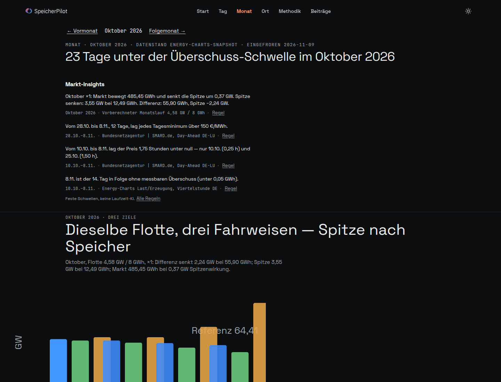 | 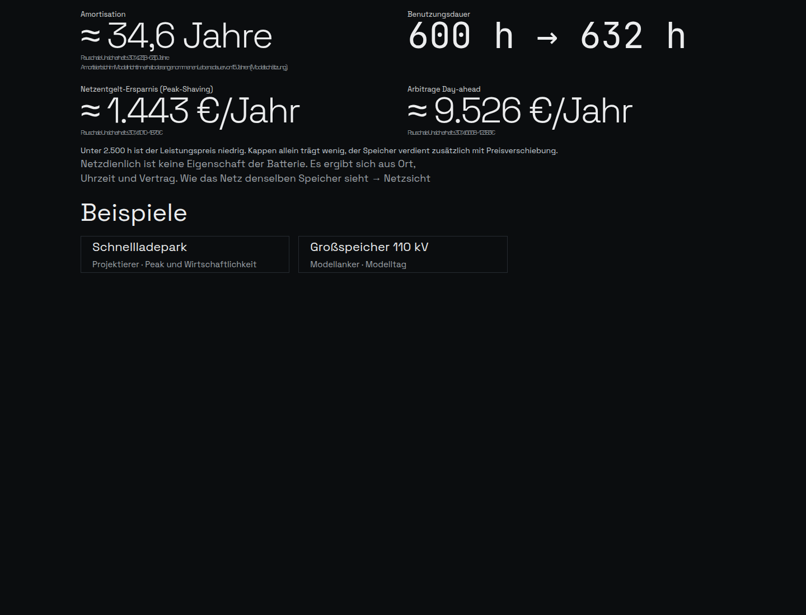 |
| 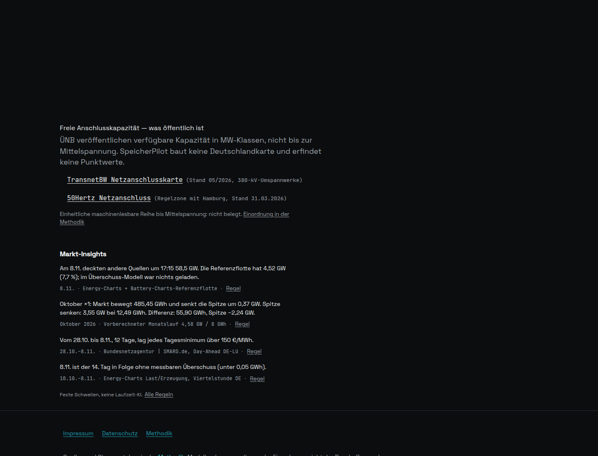 | 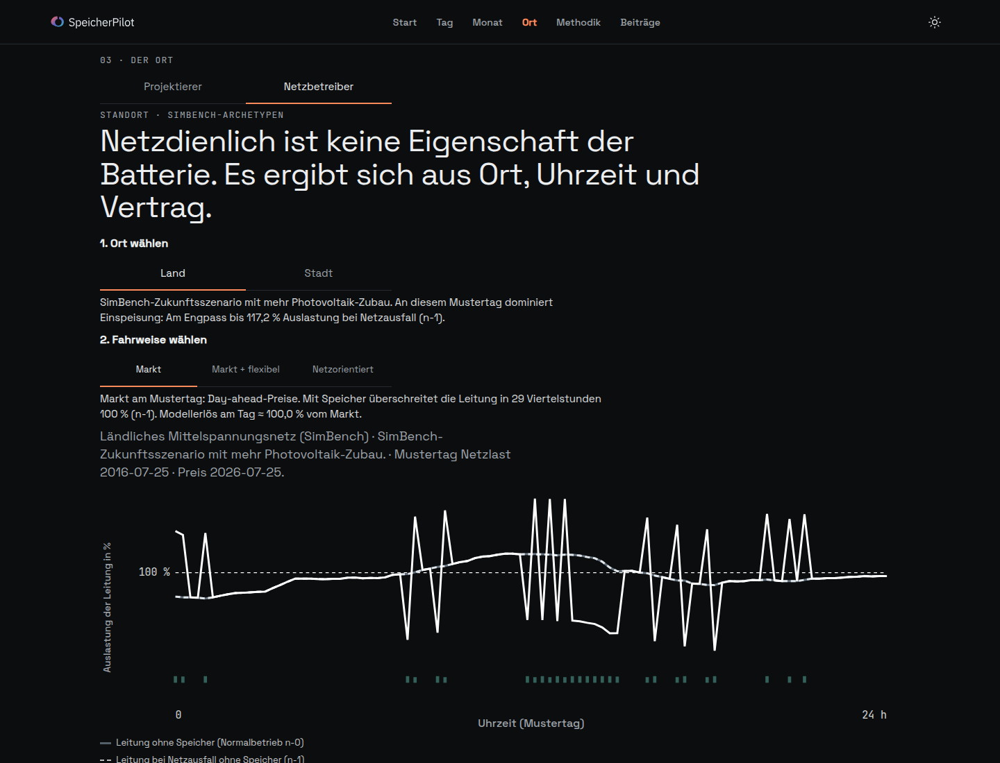 |
| 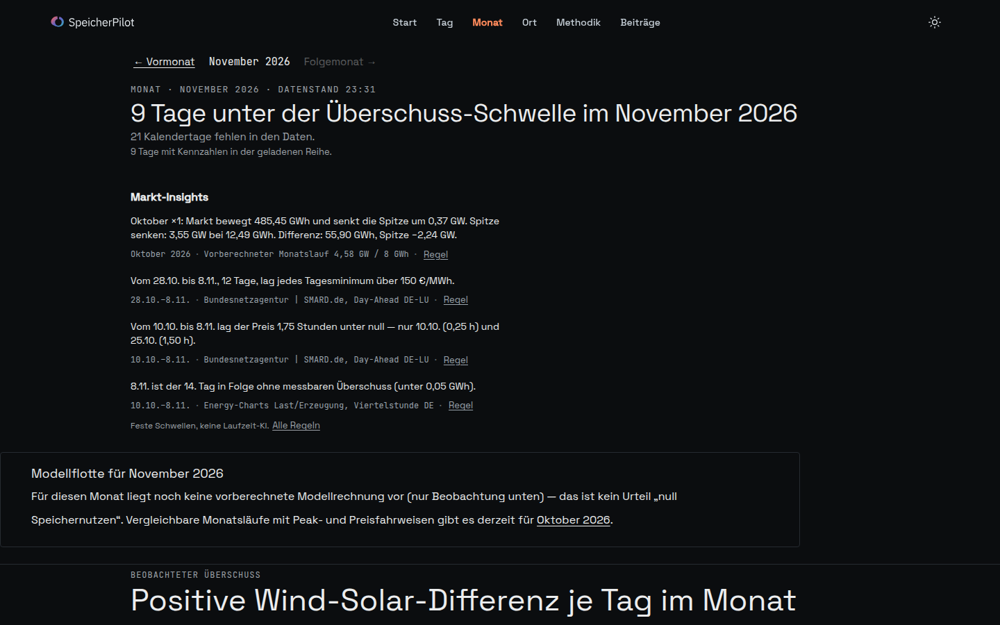 | 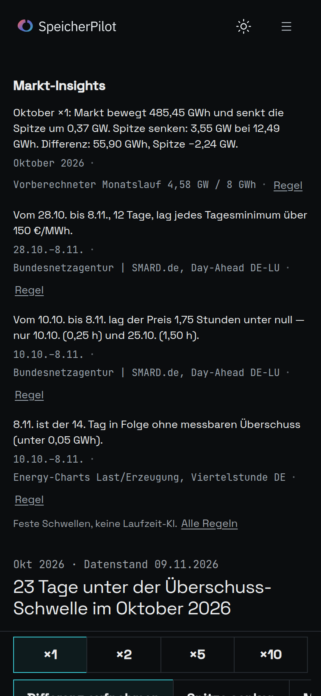 |

---

## 9. Roadmap: die drei Ideen mit dem größten Aha pro Aufwand

Jede ist ein eigenes, kleines Paket mit eigenem PR. Reihenfolge ist Empfehlung.

**1 · Echte Speicher neben dem Modell (Idee 2), Aufwand S–M.**
Eine Spur und ein Satz im Tagesgraphen auf Start und Tag. Die Daten kommen schon mit. Damit hört die Seite im Winter auf, „nichts“ zu sagen, ohne dass das Modell sich ändert. Abnahme: Satz und Spur für den 8.11. mit 30,0 / 14,6 GWh, gekennzeichnet als „beobachtet“, Methodik-Abschnitt mit Abgrenzung zwischen Pumpspeicher und Batterie.

**2 · Das Speicherjahr (Idee 1), Aufwand M.**
Eine Datenstufe (ein Jahr, statisch täglich), eine Route `/jahr` und die schmale Fassung im Start-Hero (Konzept A). Abnahme: Die Monatszählung stimmt mit `surplus-months.json` überein, 390 px ohne Überlauf, CSV der Figur (Idee 13 nebenbei).

**3 · Maßstab und Trichter (Idee 4), Aufwand S.**
Eine Zeile und eine kleine Figur auf der Startseite, ein Absatz in der Methodik. Abnahme: 9-Minuten-Rechnung mit Gegenrechnung des Tages, drei Balken mit eigenem Stichtag und Quelle, Hinweis auf Mehrfachanfragen.

**Danach**, als strategischer Schritt: **Drei Linsen (Idee 3)** als Ordnung der ganzen Seite, beginnend mit dem Aufräumen der Flottenstände und einer Palette für die Fahrweisen. Das ist die größte Wirkung, braucht aber den November-Lauf.

**Bewusst nicht jetzt:** Day-Ahead-Index (Risiko der Fehldeutung), Regelleistung (Modellerweiterung), Speicher-Atlas (Datenaufwand).

---

## Was in jedem Fall erhalten bleibt

Die 25 als große Zahl, der Tagesgraph mit der Annotation 58,5 GW, das Preisfenster, das dunkle Blatt, Space Grotesk und JetBrains Mono, die getrennten Perspektiven auf `/ort`, die Methodik als Nachschlagewerk und der Rechenkern: Round-Trip 85 %, SoC 10–90 %, Preisnehmer, nur Day-Ahead. Ebenso bleiben: Euro nur ×1 als Modellschätzung, kein Share-Button, kein OG-Bild, keine KI zur Laufzeit, kein Tesla-Branding.

---

## Anhang: Daten und Gegenrechnung

**Abrufe vom 9.11.2026, etwa 22:36 Uhr MEZ:**
- `GET https://api.energy-charts.info/total_power?country=de&start=2025-11-09&end=2026-11-08`. 35.040 Viertelstunden. Reihen: `Wind onshore`, `Wind offshore`, `Solar`, `Load (incl. self-consumption)`, `Hydro pumped storage`, `Hydro pumped storage consumption`.
- `GET https://api.energy-charts.info/price?bzn=DE-LU&start=2025-11-09&end=2026-11-08`. 35.040 Werte, EUR/MWh, Lizenz laut Antwort: „CC BY 4.0 from Bundesnetzagentur | SMARD.de“. Hinweis HEDWIG wie in Audit 2.
- Einzeltag 8.11.2026, gleiche Endpunkte.

**Rechenwege:**
- Überschuss je Tag = Σ max(0, Wind on + Wind off + Solar − Last) × ¼ h, Berliner Kalendertag, Schwelle 0,05 GWh. Das ist dieselbe Definition wie auf `/methodik`. Ergebnis je Monat: Tabelle in Abschnitt 2. Sie deckt sich mit `data/surplus-months.json` (Stand 28.10.2026) für alle vollständigen Monate.
- Jahressumme Überschuss rund 5.691 GWh. Negativpreis-Stunden im Jahr: 465 (Viertelstunden unter 0 € mal 0,25).
- Pumpspeicher 8.11.: Summe der negativen Werte der Reihe `consumption` × ¼ h = 30,0 GWh. Summe von `Hydro pumped storage` × ¼ h = 14,6 GWh. Stundenwerte: Pumpen 03–05 Uhr bis 2,9 GW, 11 Uhr 2,9 GW. Abgabe 18 Uhr 2,5 GW. Pumpspeicher speichern über mehrere Tage, deshalb sind Pumpen und Abgabe eines Tages nicht über den Wirkungsgrad gekoppelt.
- 9 Minuten: Verbrauch 8.11. 1.275,1 GWh (Startseite) / 24 h = 53,1 GW im Mittel. Flotte 8,14 GWh / 53,1 GW = 0,153 h ≈ 9,2 Minuten. ×10 ≈ 92 Minuten. Das ist eine Größenübersetzung, keine Dispatch-Aussage.
- Trichter: BNetzA-Pressemitteilung vom 12.11.2025 und SMARD-Artikel vom selben Tag (Anfragen 2024 rund 400 GW, Zusagen rund 25 GW). Bestand Battery Charts 4,64 GW (Startseite, Stand 9.11.2026). Quellen und Abgrenzung sind in Audit 2, Abschnitt 4, dokumentiert.
- Skizze `skizze-speicherjahr.png`: Raster 365 × 96, Farbe linear mit Sättigung (Überschuss bis 20 GW, Lücke bis 60 GW, Preis bis 300 €/MWh, Pumpspeicher bis 6 GW). Es ist eine Skizze für das Konzept und kein Design-Entwurf der Farbskala.

**Screens** (alle von heute Abend):
- [`screens/heute/`](screens/heute/): sechs Routen × 1440/390 × hell/dunkel, erster Bildschirm, lokaler Produktions-Build dieses Branches.
- [`screens/live/`](screens/live/): Live-Seite zum Abgleich. Der erste Bildschirm der Startseite ist identisch.
- [`screens/detail/`](screens/detail/): Ausschnitte, auf die sich Abschnitt 8 bezieht.
- [`screens/benchmark/`](screens/benchmark/): Energy-Charts, Modo Energy, The Pudding. Weitere Benchmarks (OWID, Voltplot) liegen in [`../konzept/screens/`](../konzept/screens/).

| Start 1440 dunkel | Start 390 hell | Tag 1440 dunkel |
| --- | --- | --- |
| 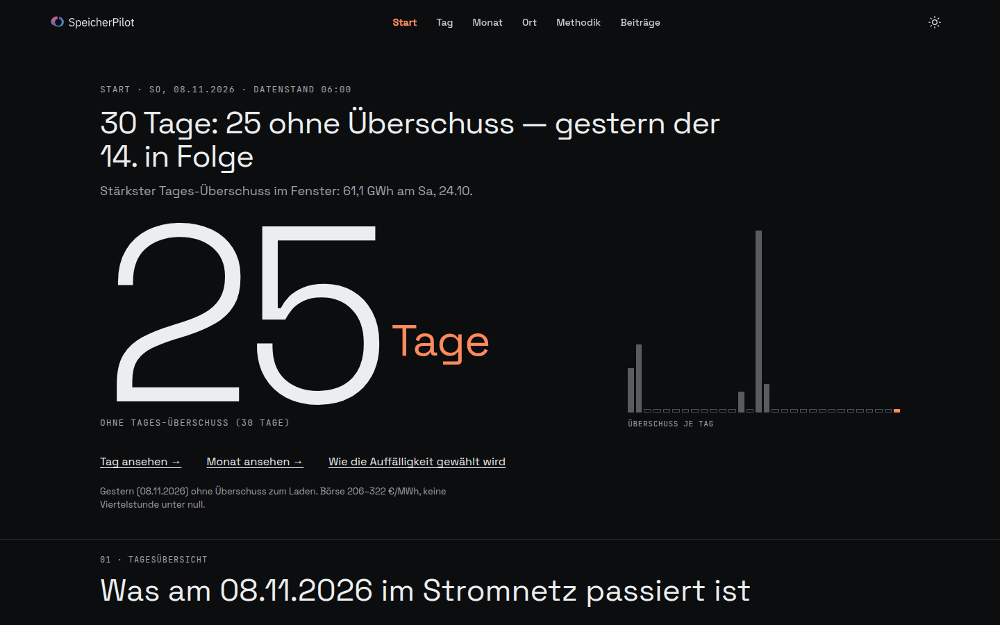 | 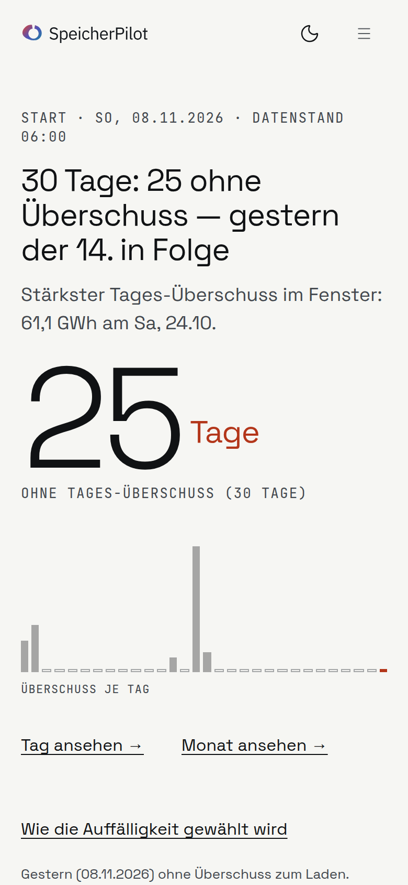 | 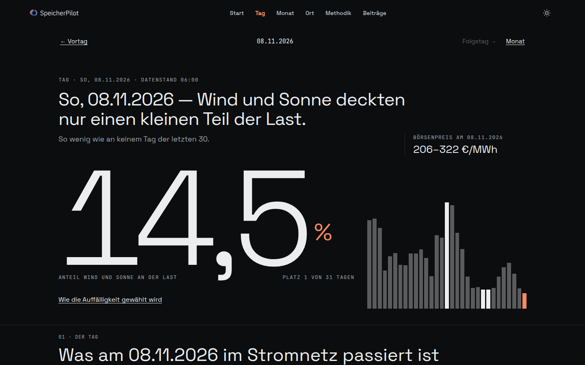 |
| **Monat 1440 hell** | **Ort 1440 dunkel** | **Methodik 1440 hell** |
| 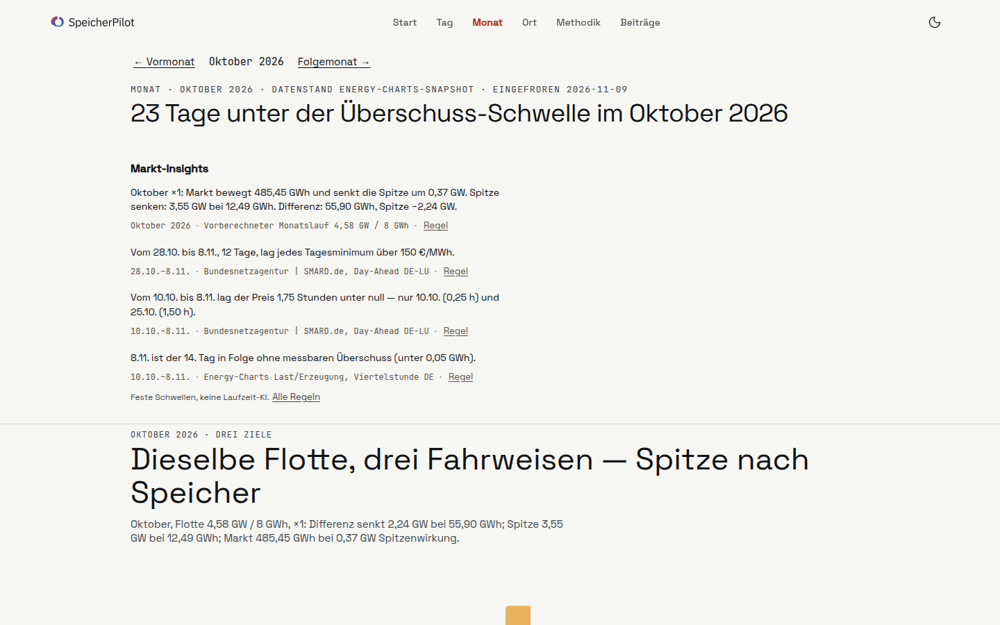 | 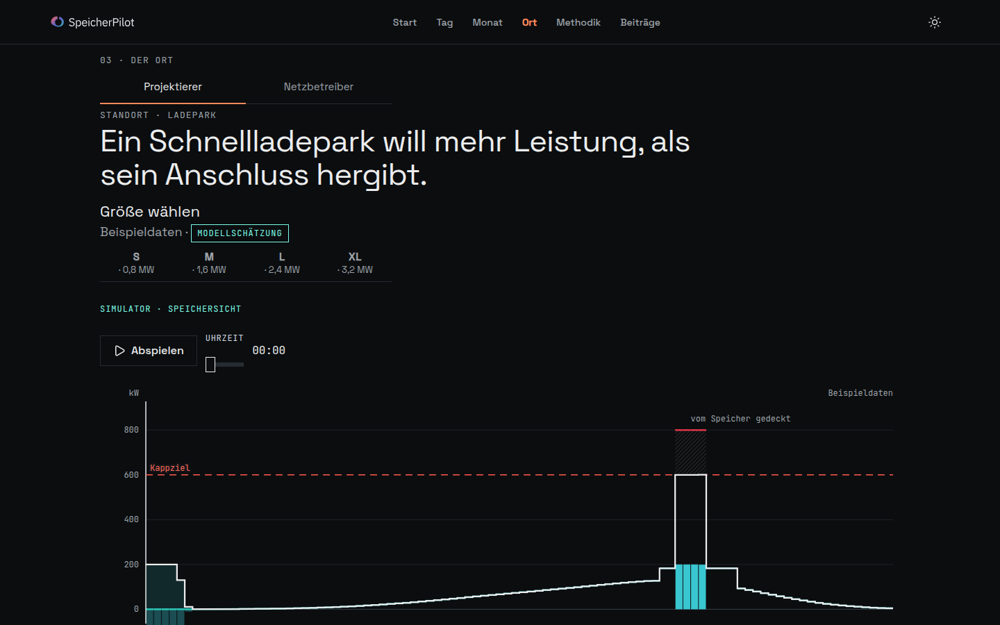 | 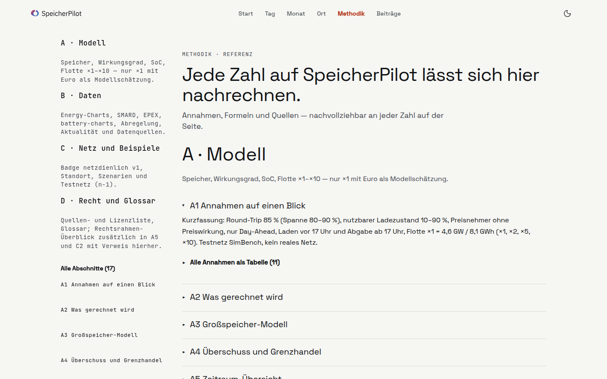 |
