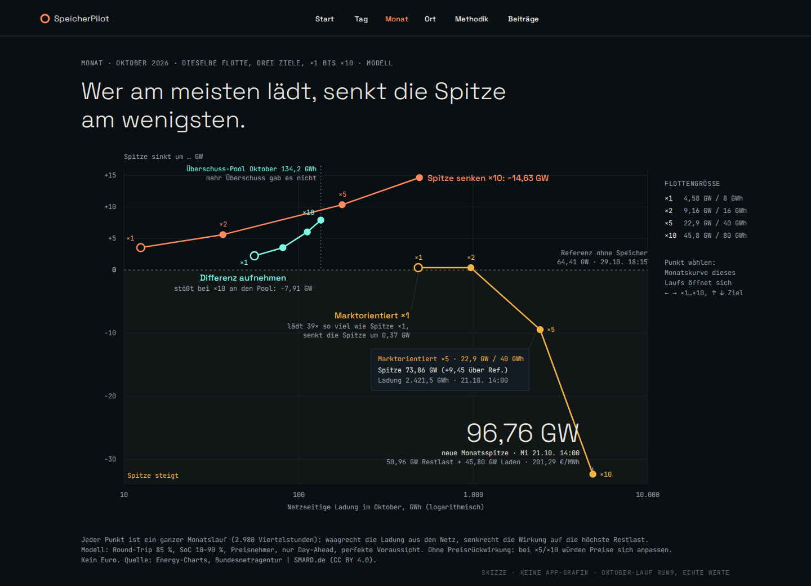
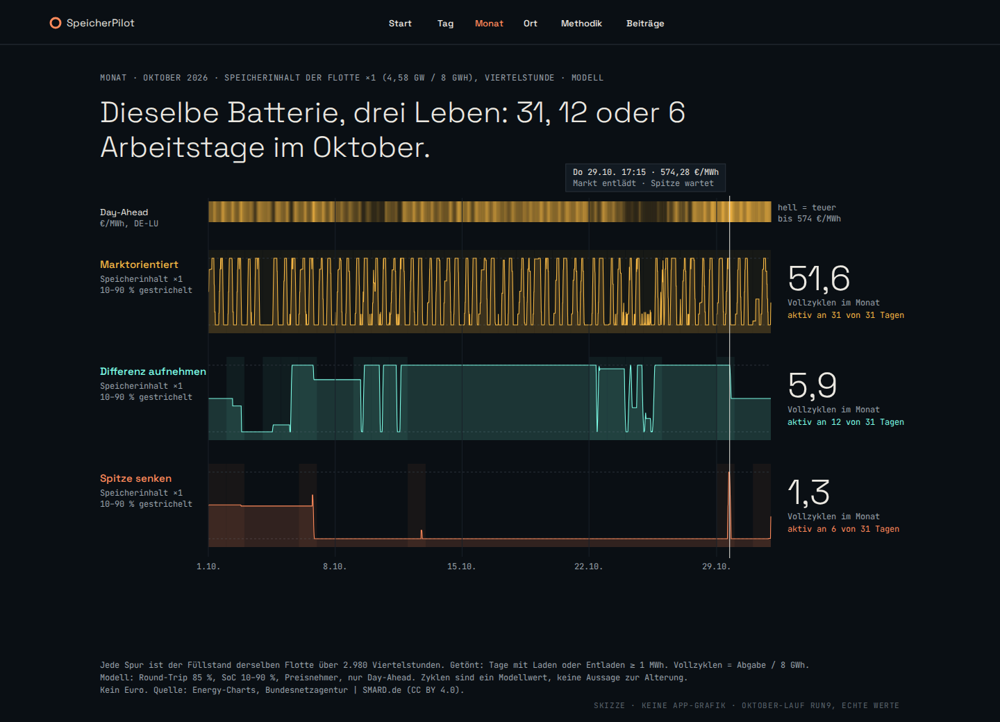
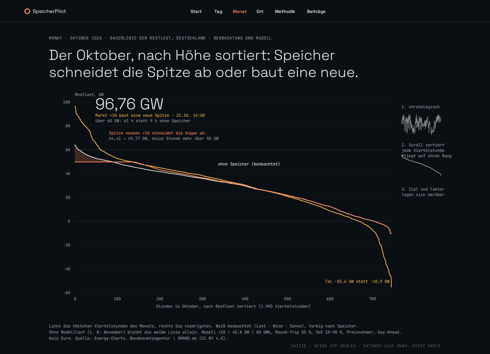

# `/monat` von Grund auf neu — drei Konzepte

Stand: Montag, 9. November 2026, spät abends. Grundlage: Branch `cursor/paket3-award-alle-ebenen-048c` (Paket 3, PR [#81](https://github.com/cophi-dev/speicherpilot/pull/81), nicht live), lokaler Produktions-Build (`next build`, `next start`), alle Routen bei 1440 dunkel und 390 hell angesehen. Gelesen: `doc/product-intent.md`, Audit 1, Audit 2, `KONZEPT.md`, Paket-3-Zielbild und -Abschlussbericht und das parallele [Konzept-Audit 3](https://github.com/cophi-dev/speicherpilot/blob/cursor/opus-konzept-audit-28d1/docs/audit-2026-11/opus-konzept/KONZEPT_AUDIT.md) (Linsen, Herde, Strichcode, `/jahr`, Pumpspeicher, Maßstab). Was dort steht, wird hier nicht wiederholt.

Auftrag nach der Ergänzung des Owners: drei klar unterschiedliche, mutige Konzepte für `/monat`, je mit Skizze, und eine Empfehlung. Der allgemeine Audit-Teil entfällt bis auf einen Absatz Widerspruch am Ende. Kein Produktcode geändert.

Alle Zahlen unten stammen aus den zwölf vorberechneten Oktober-Läufen im Repo (`data/national-fleet/2026-10/runs/*.json`, Lauf „run9“, 2.980 Viertelstunden, Modellflotte ×1 = 4,58 GW / 8 GWh). Die Skizzen sind mit diesen Reihen gezeichnet, nicht nachempfunden.

---

## Warum die heutige Seite nicht trägt

Bei 1440 Pixeln ist der erste Bildschirm Text: zwei Spalten „Modell“ und „Daten“, dann die Tabelle „Zusatznutzen gegenüber ×1“. Die Viertelstundenkurve beginnt nach rund 1.500 Pixeln und ist ein Werkzeug mit drei gestapelten Panels, keine Aussage. Der Paket-3-Vergleich zeigt die zentrale Zahl (Markt ×10, 96,76 GW) als grauen Balken, also als den unauffälligsten der Figur. Danach folgen SoC-Balken, Überschussbalken und eine Tabelle mit 31 Zeilen „ansehen“. Die Überschrift „23 Tage unter der Überschuss-Schwelle“ erzählt wieder die Leere.

Das Grundproblem ist nicht die Form. Die Seite hat die stärkste Rechnung des Projekts (zwölf Monatsläufe), aber sie zeigt sie als Tabelle und Umschalter. Die drei Konzepte machen aus diesen zwölf Läufen jeweils **ein** Bild.

Referenz heute: [`monat/heute/monat-1440-dark-fold.png`](monat/heute/monat-1440-dark-fold.png), [`monat/heute/monat-1440-dark-full.png`](monat/heute/monat-1440-dark-full.png), [`monat/heute/monat-390-light-full.png`](monat/heute/monat-390-light-full.png).

## Was in den Läufen steckt und noch nirgends steht

| Fahrweise, Oktober | Spitze nach Speicher | Netz-Ladung | Aktive Tage | Vollzyklen |
| --- | --- | --- | --- | --- |
| Differenz aufnehmen ×1 | 62,16 GW (−2,24) | 55,9 GWh | 12 von 31 | 5,9 |
| Spitze senken ×1 | 60,86 GW (−3,55) | 12,5 GWh | 6 von 31 | 1,3 |
| Marktorientiert ×1 | 64,04 GW (−0,37) | 485,5 GWh | 31 von 31 | 51,6 |
| Differenz aufnehmen ×10 | 56,50 GW (−7,91) | 134,2 GWh | 16 von 31 | 1,4 |
| Spitze senken ×10 | 49,77 GW (−14,63) | 492,8 GWh | 16 von 31 | 5,2 |
| Marktorientiert ×10 | 96,76 GW (+32,35) | 4.854,5 GWh | 31 von 31 | 51,6 |

Referenzspitze ohne Speicher: 64,41 GW am 29.10. um 18:15. Aktiver Tag: Laden plus Entladen mindestens 1 MWh. Vollzyklen: Abgabe geteilt durch die Nennenergie des Faktors.

Drei Befunde, die nur diese Läufe hergeben:

1. **Arbeit ist nicht Wirkung.** Markt ×1 lädt 39-mal so viel wie Spitze ×1 und senkt die Spitze um ein Zehntel davon. Ab ×5 kippt die Wirkung ins Gegenteil.
2. **Die Differenz-Fahrweise hat eine Wand.** Bei ×10 nimmt sie 134,2 GWh auf. Das ist der gesamte Wind-Sonne-Überschuss des Oktobers (`month_surplus_pool_gwh` in `fleet-month-meta.json`). Mehr Speicher bringt in dieser Fahrweise nichts mehr.
3. **Die Spitze wohnt in wenigen Stunden.** Ohne Speicher liegt die Restlast in 9 Stunden des Monats über 60 GW. Spitze ×10 bringt das auf 0 Stunden und keine Stunde über 50 GW. Markt ×10 bringt es auf 61 Stunden und vertieft das Tal von −10,9 auf −55,6 GW.

---

## Konzept A · Arbeit gegen Wirkung

Skizze: [`monat/konzept-a-arbeit-gegen-wirkung.svg`](monat/konzept-a-arbeit-gegen-wirkung.svg) und `.png`.

**Leitidee.** Zwölf Monatsläufe als drei Pfade in einem Bild: Wer am meisten lädt, senkt die Spitze am wenigsten.

**Story-Ablauf.**
1. Überschrift ist der Befund. Darunter sofort die Figur, kein Absatz davor.
2. Die drei Pfade laufen von ×1 nach ×10. Spitze senken steigt stetig, Differenz läuft gegen die Pool-Wand, Markt fällt ab ×5 unter die Nulllinie.
3. Die eine Annotation ist die neue Spitze: 96,76 GW, 21.10. um 14:00, 50,96 GW Restlast plus 45,8 GW Laden bei 201,29 €/MWh. Das ist die „Herde“ des anderen Audits, aber als Endpunkt einer Kurve statt als eigene Figur.
4. Ein Klick auf einen Punkt öffnet darunter die bestehende Viertelstundenkurve genau dieses Laufs. Die heutige Monatskurve bleibt erhalten, als Werkbank hinter dem Punkt.

**Hero-Graph.** Connected Scatterplot. Waagrecht die netzseitige Ladung im Monat in GWh, logarithmisch von 10 bis 10.000. Senkrecht die Veränderung der Monatsspitze in GW, Senkung nach oben. Nulllinie ist die Referenzspitze 64,41 GW. Die Fläche unter null ist leicht bernsteinfarben getönt („Spitze steigt“). Farben folgen der Größe, die die Fahrweise optimiert: Spitze = Koralle, Differenz = Mint, Markt = Bernstein. ×1 ist ein hohler Punkt (heute), ×2 bis ×10 gefüllt.

**Interaktion.** Hover oder Fokus auf einem Punkt zeigt Spitze, Zeitpunkt und Ladung. Pfeiltasten links und rechts wechseln den Faktor, oben und unten die Fahrweise, Enter öffnet die Kurve. Der Umschalter aus Knöpfen entfällt: Faktor und Fahrweise sind Koordinaten. Bei 390 Pixeln bleibt die Figur, die Beschriftung reduziert sich auf die drei Pfadnamen und die 96,76 GW. Die Werte stehen in einer `sr-only`-Tabelle.

**Echte Daten.** Die zwölf Lauf-Dateien: Maximum von `r_prime_mw` mit Zeitstempel und Preis, Summe von `c_mw` × ¼ h. `month_surplus_pool_gwh` für die Wand. Alles liegt im Repo.

**Warum award-würdig.** Die Form ist der Connected Scatterplot, den die New York Times mit „Driving Safety, in Fits and Starts“ (Hannah Fairfield, 2012) bekannt gemacht hat: zwei Größen, ein Pfad, die Zeit oder hier die Größe als Reihenfolge. Niemand zeigt die Ausbaufrage so. Energy-Charts zeigt Beobachtung, Modo Erlöse, Battery Charts Bestand. Das Bild beantwortet „was mehr Speicher bringt“ in einer Sekunde, ohne Euro, und es widerspricht der naheliegenden Annahme (mehr Ladung = mehr Entlastung). Das ist der Screenshot, den Speicherplaner, Netzplaner und Institut gleichermaßen weiterreichen, weil jeder seinen Pfad darin findet.

**Risiken.**
- Logarithmische Achse ist für Laien ungewohnt. Gegenmittel: Ticks 10 / 100 / 1.000 / 10.000 ausgeschrieben, keine Exponenten.
- Der Preisnehmer überzeichnet Markt ×5 und ×10. Das gehört an die getönte Fläche („ohne Preisrückwirkung“) und in die Fußnote, nicht in einen Warnsatz.
- Die Markt-Ladung ×1 ist eine optimale Lösung, nicht die einzige (Audit 2: rund 485 bis 496 GWh). Auf der Log-Achse sind das zwei Pixel. Methodik muss es nennen.
- Nur so viele Monate wie Läufe. Ohne November-Lauf gibt es im November kein A (siehe Voraussetzungen).
- Verlockung, die BNetzA-Zusagen 2024 (rund 25 GW) als Marke bei ×5 einzutragen. Starker Haken für LinkedIn, aber andere Stichtage und Abgrenzung. Nur als beschriftete Klammer an der Achse, nie als Prognose.

---

## Konzept B · Drei Leben

Skizze: [`monat/konzept-b-drei-leben.svg`](monat/konzept-b-drei-leben.svg) und `.png`.

**Leitidee.** Dieselbe Batterie arbeitet im Oktober an 31, 12 oder 6 Tagen. Das Ziel entscheidet, nicht der Wind.

**Story-Ablauf.**
1. Oben ein Preisband über den Monat, hell heißt teuer. Man sieht den 29.10. mit 574,28 €/MWh als hellste Stelle.
2. Darunter drei Füllstand-Spuren derselben Flotte ×1, zeitgleich, 2.980 Viertelstunden. Markt pulsiert jeden Tag, Differenz springt an den wenigen windigen Tagen, Spitze senken liegt fast flach.
3. Rechts je Spur eine große Zahl: 51,6 / 5,9 / 1,3 Vollzyklen und die aktiven Tage.
4. Ein senkrechter Cursor läuft synchron über alle Spuren. Ein Klick auf einen Tag öffnet `/tag/<datum>`. So wird die Monatsseite die Brücke zur Tagesseite, statt einer 31-Zeilen-Tabelle.

**Hero-Graph.** Drei ausgerichtete Spuren (small multiples in der Zeit), Fläche plus Linie des Speicherinhalts, 10 % und 90 % gestrichelt, aktive Tage leicht getönt. Ein Preisband als gemeinsamer Takt darüber.

**Interaktion.** Scrubben mit Maus, Finger oder Pfeiltasten (eine Viertelstunde, mit Umschalt ein Tag). Faktor ×1 / ×2 / ×5 / ×10 als einziger Schalter, die Spuren tauschen die Daten, die Form bleibt. Bei 390 Pixeln stehen die Spuren untereinander, die großen Zahlen wandern über die Spur. `prefers-reduced-motion`: kein mitlaufender Cursor, nur Tippen.

**Echte Daten.** `e_start_mwh`, `c_mw`, `d_mw` und `day_ahead_eur_mwh` je Lauf. Vollzyklen und aktive Tage sind einfache Summen.

**Warum award-würdig.** Das Bild hat die Qualität eines Seismogramms: Man muss nichts lesen, um zu sehen, dass die drei Fahrweisen drei verschiedene Maschinen sind. Für Speicherplaner ist die Zyklenzahl die Brücke zur eigenen Welt (Garantie, Auslegung), ohne dass ein Euro fällt. Für die Forschung ist die zeitliche Ausrichtung mit dem Preis nachprüfbar. Es ist die menschlichste der drei Formen: Die Batterie bekommt einen Tagesablauf.

**Risiken.**
- **Modell-Artefakt sichtbar.** Die Differenz-Fahrweise ×1 hält vom 12. bis 21.10. zehn Tage lang 90 % und gibt nichts ab, obwohl jeden Abend positive Restlast anliegt. Die Optimierung ist dort indifferent: Abgabe kostet nichts und bringt in der Zielfunktion nichts. Ein Leser sieht einen Fehler. Vor B braucht der Lauf ein zweites Kriterium (zum Beispiel frühestmögliche Abgabe oder minimaler Endbestand) und einen Satz in der Methodik.
- Vollzyklen laden zu Alterungsaussagen ein. Fußnote: Modellwert, keine Alterung.
- Die Spur „Spitze senken“ ist fast leer. Das ist der Befund, wirkt aber im ersten Moment wie ein Ladefehler. Die große Zahl rechts muss daneben stehen, nicht im Tooltip.
- Weniger stark für den Netzplaner: Die Spitze in GW ist hier nur indirekt zu sehen.

---

## Konzept C · Der Monat sortiert sich

Skizze: [`monat/konzept-c-der-monat-sortiert.svg`](monat/konzept-c-der-monat-sortiert.svg) und `.png`.

**Leitidee.** 2.980 Viertelstunden, nach Höhe sortiert: Speicher schneidet die Spitze ab oder baut eine neue.

**Story-Ablauf.**
1. Der Monat beginnt chronologisch, als die bekannte Restlastkurve.
2. Beim Scrollen fliegt jede Viertelstunde auf ihren Rang. Aus dem Zickzack wird die Dauerlinie. Das ist der eine Effekt der Seite, und er erklärt die Dauerlinie, ohne das Wort zu brauchen.
3. Fahrweise und Faktor legen sich darüber. Spitze senken ×10 schneidet die Kuppe ab (koralle Fläche, 64,41 auf 49,77 GW). Markt ×10 hebt die linke Kante auf 96,76 GW und gräbt rechts ein Tal bis −55,6 GW.
4. Eine waagrechte Marke bei 60 GW zählt die Stunden darüber: 9 ohne Speicher, 0 mit Spitze ×10, 61 mit Markt ×10.

**Hero-Graph.** Dauerlinie der Restlast (Last minus Wind minus Sonne), x in Stunden des Monats, y in GW. Weiß beobachtet, farbig nach Speicher, die abgeschnittene Kuppe als Fläche.

**Interaktion.** Scroll-Übergang chronologisch → sortiert, einmal, umkehrbar. Danach Fahrweise und Faktor wählbar. Hover auf einen Rang zeigt Datum und Uhrzeit dieser Viertelstunde, ein Klick öffnet den Tag. Bei 390 Pixeln dieselbe Figur, Übergang als Tipp-Schritt statt Scroll. Ohne Animation (`prefers-reduced-motion`) steht die sortierte Fassung mit kleiner chronologischer Vorschau daneben.

**Echte Daten.** `r_mw` (beobachtet) und `r_prime_mw` je Lauf. Für Monate ohne Lauf nur `r_mw` aus Energy-Charts, das die Seite ohnehin lädt.

**Warum award-würdig.** Die Dauerlinie ist das Arbeitsbild der Netzplanung und der Energiesystemforschung. Fraunhofer und jedes Verteilnetz lesen sie sofort. Der Sortier-Übergang macht sie für alle anderen lesbar. Diese Art von Übergang, bei dem dieselben Datenpunkte ihre Ordnung wechseln, ist das Markenzeichen guter Scrollytelling-Stücke (The Pudding, NYT Upshot). Und es ist das einzige der drei Konzepte, das auch in einem Monat ohne Modelllauf ein volles Bild zeigt.

**Risiken.**
- Die Dauerlinie verliert die Zeit. Wer wissen will, wann die Spitze war, braucht den Hover. Deshalb ist der chronologische Anfang Pflicht.
- Die Kurven liegen in der Mitte fast übereinander. Die Aussage steckt an beiden Rändern. Die Figur braucht genug Höhe, sonst ist sie bei 390 Pixeln ein Strich.
- Animation über 2.980 Punkte muss in Canvas oder mit vorberechneten Pfaden laufen, sonst leidet die mobile Performance (Paket-3-Ziel ≥ 90).
- Das Tal −55,6 GW bei Markt ×10 ist ein Preisnehmer-Effekt (Entladen bei ohnehin niedriger Restlast). Es gehört beschriftet, nicht gedeutet.

---

## Vergleich

| | A · Arbeit gegen Wirkung | B · Drei Leben | C · Der Monat sortiert sich |
| --- | --- | --- | --- |
| Frage | Was bringt mehr Speicher? | Wofür arbeitet der Speicher? | Wo wohnt die Spitze? |
| Stärkster Leser | alle drei, Netzplaner zuerst | Speicherplaner | Netzplaner, Forschung |
| LinkedIn-Screenshot | sehr stark, eine Pointe | stark, schön | stark für Fachpublikum |
| Monat ohne Lauf | nicht möglich | nicht möglich | ja, beobachtet |
| Datenbasis | vorhanden | vorhanden, Lauf braucht Tie-Breaker | vorhanden |
| Größe des Umbaus | eine neue Figur, Werkbank bleibt | neue Figur, Scrubber | neue Figur, Übergang, Canvas |
| Hauptrisiko | Log-Achse, Preisnehmer bei ×10 | Modell-Artefakt sichtbar | Performance, Zeitverlust |

## Empfehlung

**A als der eine Graph der Seite, C als zweites und letztes Bild, B nicht als eigene Figur.**

A ist die Antwort auf den Kernwunsch des Owners („Simulation, was mehr Speicher bringt“) in einer Figur, ohne Euro, mit einer Pointe, die man nicht vergisst. Es ersetzt drei heutige Flächen auf einmal: die Tabelle „Zusatznutzen“, die Faktor- und Fahrweisen-Knöpfe und den Paket-3-Drei-Ziele-Vergleich. Dieselben zwölf Zahlen, aber die Spitze Markt ×10 ist jetzt die hellste Stelle statt eines grauen Balkens.

C kommt darunter, weil es die Frage des Netzplaners präzise beantwortet und weil es die Seite im November trägt, solange kein Lauf da ist. B ist das schönste Bild, zeigt aber heute ein Artefakt des Optimierers. Seine Zahl (51,6 / 5,9 / 1,3 Vollzyklen) wandert als Tooltip-Zeile in A. Die Spuren selbst können später als Werkbank-Ansicht hinter einem Punkt von A kommen.

Seitenfolge `/monat/2026-10`:

1. Kicker (Monat, Modellflotte des Laufs 4,58 GW / 8 GWh) und Befund-Überschrift: „Wer am meisten lädt, senkt die Spitze am wenigsten.“
2. Figur A über die volle Inhaltsbreite, im ersten Bildschirm bei 1440 und bei 390.
3. Werkbank: die bestehende Viertelstundenkurve des gewählten Punkts, eingeklappt bis zur Auswahl.
4. Figur C mit eigener Befund-Zeile: „9 Stunden über 60 GW. Spitze ×10 räumt sie ab, Markt ×10 macht 61 daraus.“
5. Fußnoten in Mono: Modell, Quelle, Lizenz, Preisnehmer, nicht eindeutige Lösung, Link auf `/methodik`.

Was wegfällt: die Blöcke „Modell“, „Daten“, „Netz“ vor der Kurve (in die Fußnote und nach `/methodik`), die Tabelle „Zusatznutzen“, die Knöpfe ×1 bis ×10 und die drei Fahrweisen, die SoC-Spielraum-Balken, der Drei-Ziele-Balkenvergleich, die Überschuss-Balken und die 31-Zeilen-Tabelle (die Tage erreicht man per Klick in A und C), die Markt-Insights als Liste (ihre Zahlen werden Annotationen).

Abnahmekriterien für die Umsetzung:

- Bei 1440 dunkel und 390 hell liegt Figur A vollständig im ersten Bildschirm, ohne Fließtext davor.
- Die zwölf Punkte von A entsprechen auf zwei Nachkommastellen `peak_reduction_mw` und der Ladung in `fleet-month-meta.json`. Ein Test prüft das.
- 96,76 GW, 21.10. 14:00, 50,96 + 45,80 GW und 201,29 €/MWh stehen als Annotation am Punkt, nicht in einem Absatz.
- Jede Zahl der Seite benutzt dieselbe Flotte (Modellflotte des Laufs), mit Stand im Kicker.
- Tastatur: jeder Punkt fokussierbar, Pfeiltasten wechseln Faktor und Fahrweise, Enter öffnet die Werkbank. Lighthouse a11y 100, Performance mobil ≥ 90.
- Kein Euro, kein Share-Button, kein OG-Bild.

## Voraussetzungen vor jedem der drei Konzepte

- **Ein Lauf je Monat.** Der Solver ist da (`scripts/solve-national-fleet-month.mjs`, Python mit HiGHS, `artifacts/october-storage-counterfactual-20261107/run_fleet_factor_month.py`). Ein November-Lauf ist Datenarbeit (Eingangs-CSV aus Energy-Charts, zwölf Läufe, Bundle), keine Modellentwicklung. Bis dahin zeigt `/monat/2026-11` nur die beobachtete Dauerlinie aus C, und `/monat` leitet auf den letzten Monat mit Lauf um, mit dem Datum im Kicker.
- **Eindeutige Lösungen.** Ein zweites Kriterium im Optimierer für die indifferenten Fälle (Markt-Ladung ×1, Differenz hält zehn Tage 90 %). Sonst zeigt jede Figur, die mehr als Summen zeigt, Zufälle des Solvers.

---

## Wo ich dem parallelen Audit widerspreche

Das Konzept-Audit 3 empfiehlt, ×1 bis ×10 als vier kleine Vielfache zu zeigen. Für den Monat halte ich das für falsch: Der Faktor ist eine Größe, keine Kategorie. Er gehört auf eine Achse, wo man Sättigung (Differenz an der Pool-Wand) und Umkippen (Markt ab ×5) als Krümmung sieht. Vier Panels verstecken genau das zwischen den Rändern. Zweitens soll die Herde dort als Satz in den Fließtext. Ich würde sie weder als Satz noch als Fußnote bringen, sondern als Annotation am Endpunkt der Marktkurve; der Vorbehalt Preisnehmer gehört an die getönte Fläche. Das ist weniger Text, und der Wunsch des Owners nach gedämpftem Ton bleibt erfüllt. Drittens stuft es den November-Lauf als großen Schritt für „danach“ ein. Er ist Voraussetzung für jedes Monatskonzept, und der Solver liegt im Repo. Viertens würde ich keinen Navigationspunkt `/jahr` anlegen: Das Jahr ist die herausgezoomte Monatsseite, und eine siebte Route verdünnt die Kette. Den Befund der drei Flottenstände bestätige ich und präzisiere die Ursache: `/ort` liest die Flotte aus `data/tag-pages/roll-snapshot.json` (Battery-Charts-Stand 21.10.2026, 4,52 GW) statt aus dem Live-Dispatch wie `/tag`. Den versetzten Insights-Block auf allen Seiten verursacht `components/home/MarktInsightsBlock.module.css`: `.block { padding: 16px 0 }` setzt das `padding-inline` von `.v4-content` auf null, bei 390 Pixeln klebt der Block deshalb an der Bildschirmkante. Beides sollte Paket 3 vor dem Live-Gang beheben.
